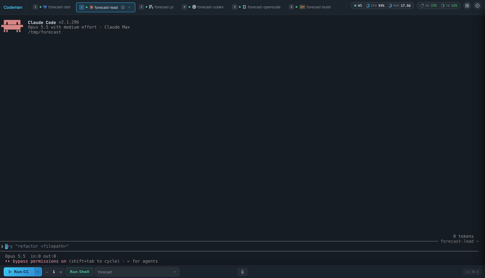
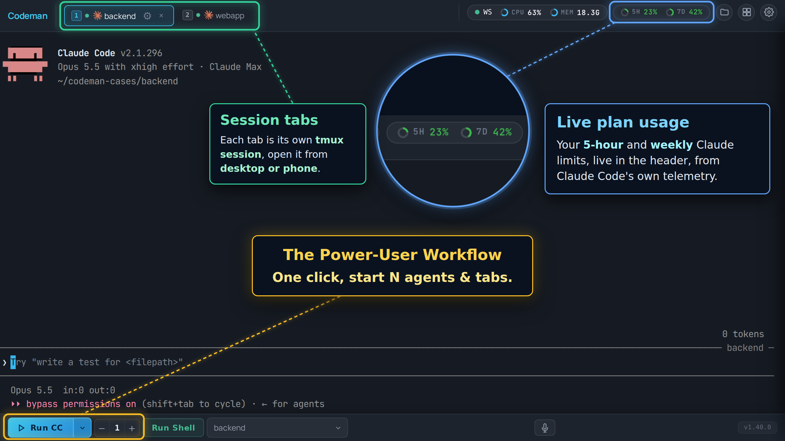
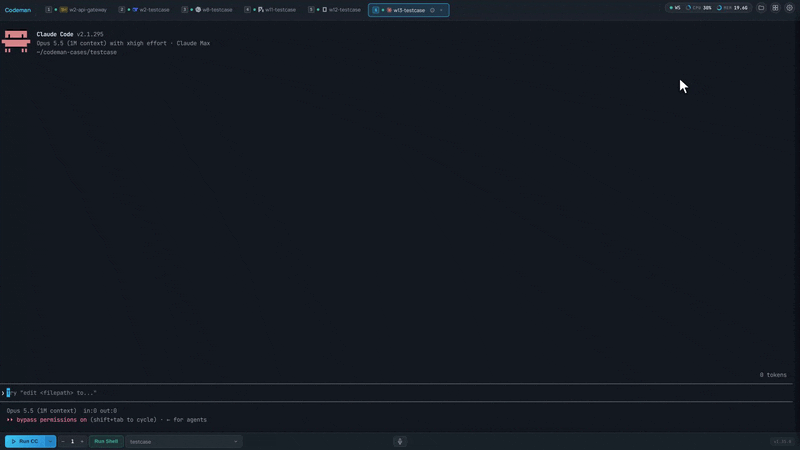
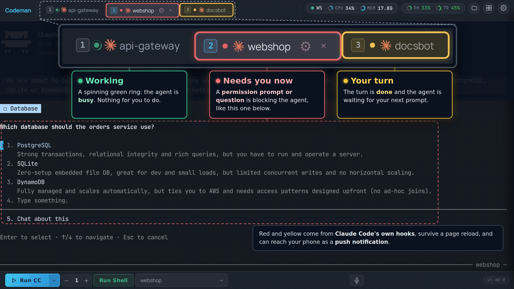
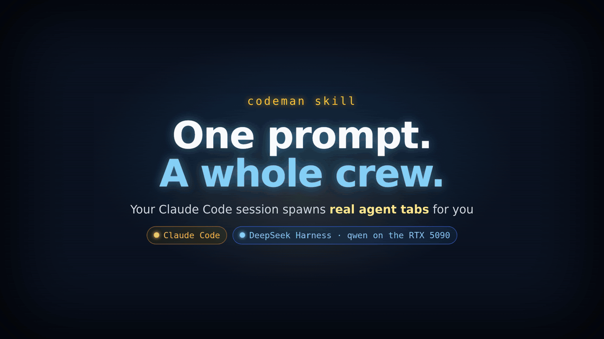
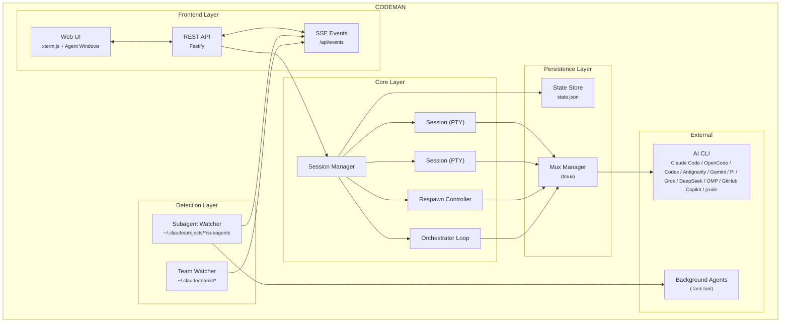

<p align="center">
  
</p>

<h2 align="center">AIコーディングエージェントのためのミッションコントロール</h2>

<p align="center">
  <em>Claude Code &bull; OpenCode &bull; Codex &bull; Antigravity &bull; Gemini &bull; Pi &bull; Grok &bull; DeepSeek &bull; OMP &bull; Copilot &bull; jcode &bull; Terminal - ひとつのダッシュボード &bull; あらゆるデバイス</em>
</p>

<p align="center">
  <a href="https://github.com/Ark0N/Codeman/releases/latest/download/Codeman.dmg"></a>
  <br>
  <sub>ネイティブMacアプリ:署名・公証済み、Apple SiliconとIntelに対応、macOS 11.3以降。<a href="#on-a-mac-the-codeman-app">できること</a></sub>
</p>

<p align="center">
  <a href="https://opensource.org/licenses/MIT"></a>
  <a href="https://nodejs.org/"></a>
  <a href="https://www.typescriptlang.org/"></a>
  <a href="https://fastify.dev/"></a>
  <a href="https://www.npmjs.com/package/aicodeman"></a>
  <a href="https://github.com/Ark0N/Codeman/stargazers"></a>
  <a href="https://github.com/Ark0N/Codeman/graphs/contributors"></a>
  <a href="https://github.com/Ark0N/Codeman/commits/master"></a>
</p>

<p align="center">
  <a href="README.md">English</a> &bull; <a href="README.zh-CN.md">简体中文</a> &bull; <strong>日本語</strong>
</p>

<p align="center">
  
</p>

**Codeman**は、AIコーディングエージェントのためのセルフホスト型ミッションコントロールです。Claude Code、OpenCode、Codex、Antigravity、Gemini、Pi、Grok、DeepSeek Harness、OMP、GitHub Copilot CLI、jcodeを永続的なtmuxセッション内で起動し、実際のターミナルを任意のブラウザへストリーミングし、あなたが席を外した後もエージェントを働かせ続けます。アイドル時には再プロンプトし、使用量制限がリセットされると再開し、スケジュールされたジョブを実行し、バックグラウンドで動くすべてのエージェントの作業をリアルタイムで表示します。

1行で始められます(macOSとLinux、WindowsはWSL経由):

```bash
curl -fsSL https://getcodeman.com/install | bash
```

```bash
codeman web
# Open http://localhost:3000 and start your first session
```

インストーラーはシステムを変更する前に毎回確認を求め、同じ1行を再実行するとその場で更新されます。詳細は[クイックスタート - インストール](#quick-start---installation)をご覧ください。

Macではターミナルを使わずに済みます。[Codeman.dmgをダウンロード](https://github.com/Ark0N/Codeman/releases/latest/download/Codeman.dmg)すると、アプリがCodemanをインストールするか、すでに実行中のものを開くか、別のマシン上のCodemanに接続します。詳しくは[Macの場合:Codemanアプリ](#on-a-mac-the-codeman-app)をご覧ください。

- **ひとつのダッシュボードで11のCLI** - セッションごとに[Claude Code、OpenCode、Codex、Antigravity、Gemini、Pi、Grok、DeepSeek、OMP、GitHub Copilot、jcode](#more-features)(さらに素のシェル)を、ローカル、[Docker内](#isolated-docker-sessions)、または[SSH経由](#remote-ssh-sessions)で実行でき、その横に独自のダッシュボードを[Webタブ](#more-features)として開けます
- **本当にスマホに優しい** - 即時ローカルエコー、QRログイン、スワイプナビゲーション、プッシュ通知を備えた[タッチ最適化ターミナル](#mobile-optimized-web-ui)
- **寝ている間も動き続ける** - [アイドル検出+再起動サイクル](#respawn-controller)と、サブスクリプションの制限リセット時の自動再開により、24時間以上の無人実行が可能です
- **エージェントの思考が見える** - すべてのサブエージェントとチームメイトの[ライブフローティングウィンドウ](#live-agent-visualization)と、リアルタイムのトランスクリプト
- **エージェント自身も操作できる** - [codemanスキル](#the-agent-skill-start-here)(すべてのエージェントCLI向け)、[`codeman agent`](#codeman-agent--session-to-session-verbs-in-every-cli-mode)、そして[MCPサーバー](#mcp-server-codeman-mcp-drive-codeman-from-any-mcp-client)により、あるエージェントが任意のCLIでワーカーを起動し、プロンプトを送り、完了を待ち、回答を収集できます
- **何も失われない** - 再起動やネットワーク切断をまたいだtmuxの永続化、exactly-onceの入力配信、スクロールバック全体のリプレイ
- **セルフホストでプライベート** - デフォルトでループバックのみ、MITライセンス、テレメトリなし、すべてあなたのマシン上で動作します

<p align="center">
  
</p>

---

## クイックスタート - インストール

```bash
curl -fsSL https://getcodeman.com/install | bash
```

これにより、Node.js、tmux、ビルドツールチェーンが不足していればインストールされ(node-ptyはLinux向けのビルド済みバイナリを提供しないため、ソースからコンパイルされます)、Codemanが`~/.codeman/app`にクローンされてビルドされます。インストーラーはマシンにすでに何があるかを確認し、最大3つの質問をした後、残りの作業をすべて無人で行い、最後にURLとスマホ用のQRコードを表示します。知っておくと良い点がいくつかあります:

- **質問は3つ、すべて最初に。** ダッシュボードへのアクセス方法、任意でtailnet上でのこのマシンの名前、そしてCodemanをバックグラウンドサービス(systemd/launchd、起動時に自動開始。Enterで「はい」)として実行するかどうかです。不足しているパッケージすべてに対する1回の同意、1回のsudoパスワード、Tailscaleのログインなど、あなたの操作が必要なものはすべてビルド前に行われるため、コンパイル中は席を外せます。
- **アクセス方法は選択できます。** **Tailscale**(`tailscale serve`を前段に置いたループバックバインドで、本物の証明書付きの`https://<machine>.<tailnet>.ts.net`が得られ、tailnetがログインとなるためパスワード不要)、**ネットワーク上の任意のデバイス**(`0.0.0.0`、パスワード設定を強く推奨するプロンプトあり)、または**このマシンのみ**(`127.0.0.1`、最も安全)から選べます。ネットワークバインドでパスワードを省略するには明示的な確認が必要で、最後に目立つ警告が表示されます。ハイライトされるデフォルトはマシンの現状を反映しており(すでに接続済みならTailscale、再実行時は既存のバインド)、Enterだけで新しいソフトウェアが導入されることはありません。ノード上の`:443`を別のアプリがすでに使っている場合、Codemanはそれを置き換えずに`https://<machine>.<tailnet>.ts.net/codeman`配下か、別のポートで提供されます。手動で起動した素の`codeman web`は、引き続きデフォルトでループバックになります。
- **名前は自由に選べます。** デフォルトでは、URLにはマシンの既存のtailnet名が使われます。2つ目の質問に「はい」と答えるとマシン名が`codeman-<hostname>`に変更されます(SSH用の名前も変わるため、デフォルトは「いいえ」です)。後から`install.sh name`で変更することもできます。
- **再実行で更新。** 同じワンライナーで、完了済みのインストールをその場で更新できます。`~/.codeman/app`内のローカル変更はstashされ(破棄されることはありません)、実行中のサービスは再起動されて検証されます。初回インストールが中断された場合は、再実行すると代わりにフルセットアップが再開されます。`install.sh status`でURLとQRコードを再表示できます。`install.sh update`、`install.sh tailscale`、`install.sh uninstall`もあります。
- **管理者権限は不要。** `sudo`のないアカウント、インストーラーが`sudo`権限を確認できないアカウント(`sudo`、`wheel`、`admin`グループに属さず、パスワードが必要なもの)、または管理者ではなく書き込み可能なHomebrewもないMacアカウントでは、インストーラーがnodejs.orgからNode.jsを、tmuxプロジェクト自身のビルドを`~/.codeman/runtime`にダウンロードし、それぞれSHA-256で検証します。また、動作するgitがない場合はソースをアーカイブとして取得します。`--no-admin`でこの方法を強制し、`CODEMAN_NO_ADMIN=0`で無効にできます。制限は2つあります。Linuxではmake、C++コンパイラー、python3があらかじめ必要で、tmuxのダウンロードにはmacOS 15以降が必要です。詳細は[wiki](https://github.com/Ark0N/Codeman/wiki/Installation#without-administrator-rights)をご覧ください。
- **せっかちな人向けのフラグ。** `curl -fsSL https://getcodeman.com/install | bash -s -- --tailscale --service`で、質問にコマンドラインから回答できます(`--lan`、`--local`、`--run`、`--no-start`、`--name <n>`、`--port <n>`、`--yes`もあります)。**CI / ヘッドレス:** ターミナルが接続されていない場合、システムを変更するステップは黙って実行されず、手順を表示して中止します。自動化でそれらを承認するには`CODEMAN_NONINTERACTIVE=1`を設定してください。

少なくとも1つのAIコーディングCLIがインストールされている必要があります — [Claude Code](https://docs.anthropic.com/en/docs/claude-code)、[OpenCode](https://opencode.ai)、[Codex](https://developers.openai.com/codex/cli)、[Antigravity](https://antigravity.google)、[Gemini CLI](https://github.com/google-gemini/gemini-cli)、[Pi](https://pi.dev)、[Grok Build](https://github.com/xai-org/grok-build)、[DeepSeek Harness](https://github.com/deepseek-ai/deepseek-harness)、[OMP](https://github.com/can1357/oh-my-pi)、[GitHub Copilot CLI](https://github.com/github/copilot-cli)、または[jcode](https://jcode.sh)(どの組み合わせでも動作します。Gemini CLIはGoogleのコンシューマー向け切り替え以降エンタープライズ専用となっており、Antigravityがその後継です)。インストーラーは11種類のうち存在するものを検出します。何も見つからない場合はメニューから任意のものをインストールするよう提案します(DeepSeekは除きます。そのnpmパッケージは実行可能なプロファイルのないランチャーしかインストールしないためです)。スキップして後で自分でインストールすることもできます。インストール後:

```bash
codeman web
# Open http://localhost:3000 and start your first session
```

**小さなチームで共有しますか?** 代わりにマルチユーザーモードで起動すると、各メンバーが独自のログインとワークスペースを持てます。

```bash
codeman users add alice --admin      # create the first admin account
codeman web --multiuser              # named logins + per-user case spaces
```

詳細は下記の[マルチユーザーモード](#multi-user-mode-opt-in)をご覧ください。

**Docker Composeが好みですか?** リポジトリをクローンして、スクリプトを1つ実行します(Linux、Compose v2プラグイン付きのDocker):

```bash
git clone https://github.com/Ark0N/Codeman.git && cd Codeman
bash docker/Start-Codeman.sh
```

初回実行時には3つの質問(データフォルダー、ポート、パスワード。Enterで生成されたパスワードを含むデフォルト値を採用)があり、`docker/.env`を自動で書き出し、イメージをビルドし、Codemanが応答した時点でURLを表示して終わります。イメージにはClaude Code、Codex、Gemini CLI、OpenCodeがすでに含まれています。Codemanはコンテナ内で動作し、ホストのソケットを通じてDockerケースを兄弟コンテナとして起動します。更新するには、**App Settings → Updates**を使うか、素の`docker compose up`ではなく`git pull`してスクリプトを再実行してください。そうすることで、再ビルドされたイメージ、更新されたボリューム、エントリポイントが揃って反映されます。Unraid、Composeコマンドの直接実行、ストレージやネットワークのオプションについては[Dockerデプロイガイド](docker/README.md)をご覧ください。

### Macの場合:Codemanアプリ

**[Codeman.dmgをダウンロード](https://github.com/Ark0N/Codeman/releases/latest/download/Codeman.dmg)** · Apple SiliconとIntelに対応したユニバーサルアプリ · macOS 11.3以降

Codemanを専用ウィンドウで開く小さなネイティブアプリです。CodemanのないMacでは、ターミナルも管理者パスワードも使わずにCodemanをインストールし、インストールの進捗をチェックリストで表示し、まだコーディングエージェントがなければそのインストールも提案します。すでにCodemanが動いているMacでは、サーバーを見つけて開くか、停止していれば起動します。**Another machine**では、Mac mini、ホームサーバー、またはtailnet上のCodemanに接続でき、パスワードはキーチェーンに保存されます。また、SSH経由でそちらにインストールを開始することもできます。天板のロゴが光るPROLED XDRディスプレイ搭載のMacBook Proでは、**View > Blink Apple Logo**でロゴがエージェントの状態を表示します。作業中はゆっくり明滅し、エージェントがあなたを待っているときは点滅し、許可が必要なときはフラッシュします。各状態には独自のスタイルを設定できます。自分でオンにするまではオフのままです。それ以外の時間にロゴを消したり、暗くしたり、エフェクトを付けたりするには[LogoLight](https://github.com/Ark0N/LogoLight)(`brew install --cask ark0n/tap/logolight`)があり、Codemanがロゴを点滅させている間は動作を控えます。このアプリはブラウザを同梱せず、macOS自身のWebKitをRustで包んだものなので、ダウンロードサイズは5MB未満です。

`Codeman.dmg`を開き、Codemanをアプリケーションフォルダーにドラッグして、そこから開いてください。macOSがインターネットからダウンロードしたアプリを開くかどうかを一度だけ尋ねるので、**Open**をクリックします。

- **アプリを終了してもCodemanは停止しません。** アプリからインストールした場合、Codemanはログイン時に起動するLaunchAgentとして動作するため、ウィンドウを閉じてもエージェントは動き続け、ブラウザやスマホからも従来どおりアクセスできます。
- **CodemanのページにはSafari 16.4のWebKitが必要です。** アプリ自体はmacOS 11.3で起動しますが、Codeman本体にはmacOS 13.3以降、またはSafari 16.4以降をインストールしたmacOS 11か12が必要です。古いWebKitでは、アプリがその旨を表示し、接続しません。
- **アプリからのインストールにはmacOS 15、またはインストール済みのtmuxが必要です。** tmuxはtmuxプロジェクト自身のビルドから取得され、これにはmacOS 15が必要です。tmuxのない古いMacでは、アプリは代わりにターミナルを提案し、そこでHomebrewがtmuxをインストールします(一度だけ管理者権限が必要です)。
- **更新について。** アプリはまだ自動更新しません。新しい`Codeman.dmg`をダウンロードし、古いコピーの上にドラッグしてください。

初回起動、既知の制限、自分でビルドする方法については、wikiの[Installation](https://github.com/Ark0N/Codeman/wiki/Installation#on-a-mac-the-codeman-app)と[packages/desktop/README.md](packages/desktop/README.md)をご覧ください。

<details>
<summary><strong>バックグラウンドで実行し続ける</strong></summary>

何も設定せずに、起動したシェルが終了した後も動かし続けるには:

```bash
codeman web -d          # detach; logs to ~/.codeman/web.log
codeman web --status    # is it up, and on which pid
codeman web --stop      # graceful SIGTERM; agents keep running in tmux
```

`-d`はサーバーが実際に応答するまで待ってから成功を報告し、同じデータディレクトリで2つ目のサーバーを起動することを拒否します(tmuxソケットを共有する2つのサーバーは、互いのセッションにアタッチしてしまいます)。

再起動後も復帰させるには、代わりにサービスとしてインストールしてください。インストーラーの最後のメニューでこれを行えます(オプション2)。`npm i -g aicodeman`でインストールした場合は`codeman service`が同等の機能です:

```bash
codeman service install     # systemd user unit (Linux) or LaunchAgent (macOS)
codeman service status
codeman service uninstall
```

`service install`は現在のPATHを埋め込んだユニットを書き出します。これは見た目以上に重要です。launchdはジョブに`/usr/bin:/bin:/usr/sbin:/sbin`しか渡さないため、Homebrewやnvmで入れた`node`、`tmux`、`claude`は手書きのplistからは見えません。`CODEMAN_PASSWORD`がユニットファイルにコピーされることはないので、サービスに認証が必要な場合は自分で追加してください。

代わりにユニットを手書きする場合:

**Linux(systemd):**

```bash
mkdir -p ~/.config/systemd/user
cat > ~/.config/systemd/user/codeman-web.service << EOF
[Unit]
Description=Codeman Web Server
After=network.target

[Service]
Type=simple
ExecStart=$(which node) $HOME/.codeman/app/dist/index.js web
Restart=always
RestartSec=10

[Install]
WantedBy=default.target
EOF
systemctl --user daemon-reload
systemctl --user enable --now codeman-web
loginctl enable-linger $USER
```

**macOS(launchd):**

```bash
mkdir -p ~/Library/LaunchAgents
cat > ~/Library/LaunchAgents/com.codeman.web.plist << EOF
<?xml version="1.0" encoding="UTF-8"?>
<!DOCTYPE plist PUBLIC "-//Apple//DTD PLIST 1.0//EN"
  "http://www.apple.com/DTDs/PropertyList-1.0.dtd">
<plist version="1.0">
<dict>
  <key>Label</key>
  <string>com.codeman.web</string>
  <key>ProgramArguments</key>
  <array>
    <string>$(which node)</string>
    <string>$HOME/.codeman/app/dist/index.js</string>
    <string>web</string>
  </array>
  <key>RunAtLoad</key><true/>
  <key>KeepAlive</key><true/>
  <key>StandardOutPath</key>
  <string>/tmp/codeman.log</string>
  <key>StandardErrorPath</key>
  <string>/tmp/codeman.log</string>
</dict>
</plist>
EOF
launchctl bootstrap gui/$(id -u) ~/Library/LaunchAgents/com.codeman.web.plist
```

</details>

<details>
<summary><strong>Windows(WSL)</strong></summary>

```powershell
wsl bash -c "curl -fsSL https://getcodeman.com/install | bash"
```

Codemanにはtmuxが必要なため、Windowsユーザーには[WSL](https://learn.microsoft.com/en-us/windows/wsl/install)が必要です。まだWSLがない場合は、管理者権限のPowerShellで`wsl --install`を実行して再起動し、Ubuntuを開いてから、WSL内でお好みのAIコーディングCLI([Claude Code](https://docs.anthropic.com/en/docs/claude-code)、[OpenCode](https://opencode.ai)、[Codex](https://developers.openai.com/codex/cli)、[Antigravity](https://antigravity.google)、[Gemini CLI](https://github.com/google-gemini/gemini-cli)、[Pi](https://pi.dev)、[Grok Build](https://github.com/xai-org/grok-build)、[DeepSeek Harness](https://github.com/deepseek-ai/deepseek-harness)、または[OMP](https://github.com/can1357/oh-my-pi))をインストールしてください。インストール後は、Windowsのブラウザから`http://localhost:3000`にアクセスできます。

</details>

---

## モバイル最適化されたWeb UI

あらゆるスマートフォンで、最もレスポンスの良いAIコーディングエージェント体験を提供します。ローカルエコー付きの完全なxterm.jsターミナル、スワイプナビゲーション、そして本格的なリモート作業のために設計されたタッチ最適化インターフェースを備えています。デスクトップUIを小さな画面に詰め込んだものではありません。

<table>
<tr>
<td align="center" width="40%"></td>
<td align="center" width="60%"></td>
</tr>
<tr>
<td align="center"><em>タッチでプロンプトに回答</em></td>
<td align="center"><em>アクセサリバー + 専用のEnterボタン</em></td>
</tr>
</table>

<table>
<tr>
<th>ターミナルアプリ</th>
<th>Codeman Mobile</th>
</tr>
<tr><td>リモート経由で200〜300msの入力遅延</td><td><b>ローカルエコー — 即座にフィードバック</b></td></tr>
<tr><td>小さな文字、コンテキストなし</td><td>完全なxterm.jsターミナル</td></tr>
<tr><td>セッション管理なし</td><td>スワイプでセッションを切り替え</td></tr>
<tr><td>通知なし</td><td>承認待ちとアイドル時のプッシュ通知</td></tr>
<tr><td>手動で再接続</td><td>tmuxによる永続化</td></tr>
<tr><td>エージェントの状況が見えない</td><td>バックグラウンドエージェントをリアルタイム表示</td></tr>
<tr><td>スラッシュコマンドをコピー&ペースト</td><td>ワンタップで<code>/init</code>、<code>/clear</code>、<code>/compact</code></td></tr>
<tr><td>スマートフォンでパスワード入力</td><td><b>QRコードスキャン — 即座に認証</b></td></tr>
</table>

- **キーボードアクセサリバー** — 仮想キーボードの上に`/init`、`/clear`、`/compact`のクイックアクションボタンを表示します。破壊的なコマンドは確認のために2回押す必要があるため、誤って実行することはありません。Codexセッションでは`⇧←`/`⇧→`(Shift+Left/Shift+Right: キューに入れた最後のメッセージを編集/プロンプトスタックを戻る)も表示されます
- **専用のEnterボタン** — キー入力をターミナル経由で再送するため、ローカルエコーでバッファされたテキストが取り残されることなく先にフラッシュされます
- **添付ボタン**: マイクの横にある画像アイコンを押すと、キーボードを表示せずにシステムの写真・ファイルシートが開きます。写真やカメラロールの動画(mp4、mov、webm、最大1GB)はセッションのフォルダにアップロードされ、そのパスが未送信の状態でプロンプトに入力されます
- **シェルへの貼り付け**: 複数行の貼り付けは、届いた順に1行ずつ実行されるのではなく、1つのブロックとして入力され、Enterを押すまで待機します
- **スワイプナビゲーションとスマートなキーボード処理** — 左右にスワイプしてセッションを切り替えられます。キーボードが開くとツールバーとターミナルが上に移動します(`visualViewport` API)
- **スマートフォン向けに設計** — ノッチやホームインジケーター用のセーフエリアインセット、44pxのタッチターゲット、ボトムシート形式のcaseピッカー、ネイティブの慣性スクロールを備えています。折りたたみ式スマートフォン(iPhone Duo)ではダイアログがヒンジを避けて表示され、端末の開閉がキーボードと誤認されることはありません

```bash
codeman web --https
# Open on your phone: https://<your-ip>:3000
```

> `localhost`は通常のHTTPで動作します。別のデバイスからアクセスする場合は`--https`を使用するか、[Tailscale](https://tailscale.com/)(推奨)を使用してください。インストーラーで設定できます(ネットワークアクセスのプロンプトで**Tailscale**を選択するか、既存のインストールで`bash ~/.codeman/app/install.sh tailscale`を実行します)。これにより、本物の証明書付きの`https://<your-machine>.<tailnet>.ts.net`が使えるようになります。tailnet内に限定され、パスワードは不要で、スマートフォンでのPWAインストールとプッシュ通知も動作します。インストーラーは最後にそのURLとスキャン用のQRコードを表示し、`bash ~/.codeman/app/install.sh status`でいつでも再表示できます。

### 安全なQRコード認証

スマートフォンのキーボードでパスワードを入力するのは苦痛です。Codemanはこれを**暗号学的に安全な使い捨てQRトークン**に置き換えます。デスクトップに表示されたコードをスキャンするだけで、スマートフォンが即座に認証されます。

各QRには、サーバー上の256ビットのシークレット(`crypto.randomBytes(32)`)に対応する6文字のショートコードを含むURLがエンコードされています。トークンは**60秒**ごとに自動でローテーションされ、**最初のスキャンでアトミックに消費**され(リプレイは常に失敗します)、レスポンスのタイミングから何も漏らさない**ハッシュベースの`Map.get()`ルックアップ**を使用します。ショートコードは不透明なポインタであり、本物のシークレットがブラウザ履歴、`Referer`ヘッダー、Cloudflareのエッジログに現れることはありません。

このセキュリティ設計は、["Demystifying the (In)Security of QR Code-based Login"](https://www.usenix.org/conference/usenixsecurity25/presentation/zhang-xin)(USENIX Security 2025。上位100サイトのうち47サイトに脆弱性が見つかりました)で特定された6つの重大なQR認証の欠陥すべてに対処しています。すなわち、使い捨ての強制、短いTTL、暗号学的乱数、サーバー側での生成、スキャン時のリアルタイムなデスクトップ通知(QRLjackingの検知)、そして手動失効が可能なIP + User-Agentによるセッションバインディングです。二層のレート制限(IP単位 + グローバル)により、62^6 = 568億通りのコードに対する総当たり攻撃は実行不可能です。完全なセキュリティ分析: [`docs/qr-auth-plan.md`](docs/qr-auth-plan.md)

---

## Codemanの使い方 — 人間のためのガイド

ブラウザからCodemanを操作するための、最初から最後までのウォークスルーです。インストールしたばかりなら、ここから始めてください。

### 1. サーバーを起動する

```bash
codeman web                       # localhost:3000 (loopback only — safe default)
codeman web --port 8080           # custom port (or set CODEMAN_PORT)
codeman web --https               # self-signed TLS (only needed for remote access)
codeman web -H 0.0.0.0            # bind LAN — REQUIRES CODEMAN_PASSWORD (see Security)
codeman web -d                    # detach: survives closing the shell (--status, --stop)
codeman service install           # systemd/launchd service: comes back after reboots
```

表示されたURLを開きます。ページは単一のダッシュボードで、以下のすべての操作はそこで行います。

### 2. 最初のセッションを作成する

**+ New Session**(または**Quick Start**)をクリックします。セッションとは、tmuxをバックエンドとする専用ターミナルで動作する1つのAI CLIのことです。次の項目を選択します。

| 項目                        | 説明                                                                                                        |
| ---------------------------- | ------------------------------------------------------------------------------------------------------------------- |
| **Working directory / case** | エージェントが作業するフォルダです。「case」とは、Codemanが記憶している名前付きの作業ディレクトリのことです。**Add Case**では、新規作成、既存フォルダのリンク、またはGitHubリポジトリを直接クローン(**Clone Repo**)してcaseを作成できます。 |
| **CLI / run mode**           | `Claude`(デフォルト)、`OpenCode`、`Codex`、`Antigravity`、`Gemini`、`Pi`、`Grok`、`DeepSeek`、`OMP`、`Copilot`、`jcode`、または`Terminal`(通常のシェル)。 |
| **Model**                    | セッションごとのモデルです(App Settings → Models → New Claude sessions)。ソフトなデフォルトであり、セッション内で`/model`も引き続き使えます。                  |
| **Effort / Ultracode**       | 推論のeffort(`low`〜`max`)、または動的なマルチエージェントワークフロー用の`ultracode`です。`/effort`でいつでも切り替えられます。 |

開始すると、Codemanは実際のPTYを介してCLIを起動し、SSE経由でブラウザにストリーミングします。

### 3. ダッシュボードを読む

- **タブ(上部)** — セッションごとに1つ。`Alt+1`〜`9`でジャンプ、`Ctrl+Tab`で次へ、ドラッグで並べ替えができます(タブの順序はデバイス間で同期されます)。リスト形式が好みなら、**App Settings → Appearance → Tabs**で、フィルターボックス付きの左サイドバー(`Alt+B`で折りたたみ)か、アクティビティ順に行が並ぶ縦型レールに移動できます。並び順は、あなたの対応待ちのものが先頭、次に最も長く実行中のもの、次に最近静かになったものです。レールには**Search sessions**ボックス、名前付きの**tab groups**(グループのメニューから**New session**で直接そのグループにセッションを開始できます)、そしてよく使うタブへのショートカットを集めた**Focus**セクションもあります。
- **ターミナル(中央)** — 本物の`xterm.js`ターミナルで、フルTUIも正しく描画されます。直接入力し、**Enter**を押して送信します。`Shift+Enter`で改行を挿入します。
- **サイドパネル** — Respawn、Orchestrator、Cron、Subagents、Settings(ツールバーから切り替え)。

### 4. エージェントと対話する

- **プロンプトを入力** — ターミナルに直接入力します。入力は再接続をまたいでも確実に1回だけ届けられます(接続が切れてもプロンプトが失われたり二重送信されたりすることはありません)。
- **画像、動画、ドキュメントを貼り付け、ドロップ、添付** (PDF、Officeファイル、zip、プレーンテキスト)してセッションに直接渡せます。これらはワークスペース内の隠しフォルダ`.codeman-uploads/`に保存され(gitでは自動的に無視され、7日後に削除されます)、ファイルのパスが未送信の状態でプロンプトに入力されます。
- **音声入力** — `Ctrl+Shift+V`(Deepgram Nova-3、またはAPIキー不要でこのマシンのClaude Codeログインを使用。無音で自動停止)。
- **添付ファイル** — 外部ファイルやドキュメントを登録し、Office/PDFをインラインでプレビューできます。エージェントが出力したファイルパスは、ターミナルでもチャットビューでもクリック可能で、`~/`や相対パス、複数行にまたがったパスにも対応しています。`.html`レポートは実際のページとして、Markdownはレンダリングされた状態で、フォルダはファイルのグリッドとして開きます。
- **対応が必要なとき** — タブが黄色(入力待ち)または赤(質問によりブロック中)に変わります。**Approvals Inbox** _(オプトイン)_ は、Claude Code、Codex、DeepSeek Harnessセッションからのあなたの対応待ちプロンプトを1つのリストにまとめます。Claudeのプロンプトはヘッダーのベルから、Claudeのダイアログはスマートフォンのホーム画面からも、Claudeの権限プロンプトはプッシュ通知のApprove/Denyボタンからも回答できます。CodexとDeepSeekの項目はターミナルで回答するよう促すアラートで、その他のCLIからのプロンプトはここには入りません。🧠 **Read My Mind** _(オプトイン)_ は、caseの目標と最近の作業から次のプロンプトの下書きを作成します。
- **見えているものをコピー** — `Shift+drag`でCLIがマウスを占有していてもテキストを選択でき、右クリックでコピーされます。Auto Copy _(オプトイン)_ は選択を離した瞬間にコピーします。OSC 52でコピーするプログラム(Claude Codeの`/copy`、tmuxのyank、vim)も、ブラウザのクリップボードにテキストを送ります。

### 5. 自律的に動かす

| モード             | 用途                                                                                                                        | 場所                                                               |
| ---------------- | --------------------------------------------------------------------------------------------------------------------------------- | ------------------------------------------------------------------- |
| **Respawn**      | 長時間の無人実行 — アイドル時や制限到達時に、適応的なタイミングでCLIを自動再起動します。プリセット: `solo-work`、`overnight-autonomous`、… | Respawnタブ                                                         |
| **Orchestrator** | 1つの目標を段階的な計画に変換し、複数のエージェントで完了まで推進します。                                                        | Orchestratorパネル                                                  |
| **Cron**         | スケジュール(`once`/`interval`/`daily`/`weekly`)に従って実行される名前付きの保存済みジョブで、時刻になるとセッションを起動してプロンプトを送信します。             | ⏰ Cronボタン _(オプトイン: App Settings → Header & Panels → Scheduling)_ |
| **Auto-resume**  | サブスクリプションのレート制限がリセットされた後、自動的に作業を再開します。                                                                    | Respawnタブ(上部)                                                   |

### 6. どこからでもアクセスする

- **スマートフォン/タブレット** — UIは完全にタッチ最適化されています。デスクトップの**QRコード**をスキャンすれば、パスワードを入力せずにログインできます。
- **ネットワークの外から** — `./scripts/tunnel.sh start`でCloudflareトンネルを開きます(先に`CODEMAN_PASSWORD`を設定してください)。
- **SSH** — `codeman tui`はターミナル上のフルスクリーンダッシュボードです(`codeman tui --list`で一覧表示、`codeman tui 2`で特定のセッションに直接アタッチ)。

### 7. 運用と保守

- **App Settings** — モデル、effort、権限の起動モード、テーマ/スキン、ターミナルのフォントファミリーとウェイト、入場アニメーションとタイルアニメーション(専用の**Animations**セクション)、通知(トーストとブラウザ通知の表示時間を調整可能)、表示の切り替え、CLIごとのオプション、同期されるカスタム表示名、デバイスごとの英語/簡体字中国語のUI言語を設定できます。**Apply**を押すとSettingsを閉じずに保存します。
- **バックグラウンドで実行** — `codeman web -d`はシェルから切り離して実行します(`--status`、`--stop`)。`codeman service install`は、再起動後も維持されるsystemdユーザーユニット/macOS LaunchAgentとして登録します。どちらも成功を報告する前にサーバーが実際に応答することを確認し、1つのデータディレクトリで2つ目のサーバーを起動することを拒否します。[バックグラウンドで実行し続ける](#quick-start---installation)を参照してください。
- **セルフアップデート** — git cloneでのインストールは、**App Settings → System → Updates**からその場で更新できます。
- **独自の変更をデプロイ** — [開発](#development)を参照してください。

> ⚠️ **安全上の注意:** Codemanが管理するセッションの_中で_作業している場合(`echo $CODEMAN_MUX` → `1`)、`tmux kill-session`/`pkill claude`を直接実行しないでください。Web UIまたは`./scripts/tmux-manager.sh`を使用してください。

---

## ゼロラグ入力オーバーレイ

<p align="center">
  
</p>

コーディングエージェントにリモートでアクセスする場合(VPN、Tailscale、SSHトンネル)、通常はキー入力のたびに往復で200〜300msかかります。Codemanは**Moshに着想を得たローカルエコーシステム**を実装しており、レイテンシに関係なく入力が即座に反映されるように感じられます。

xterm.js内のピクセルパーフェクトなDOMオーバーレイが、キー入力を0msで描画します。バックグラウンドでの転送が、50msのデバウンスでまとめた各文字を静かにPTYへ送信するため、Tab補完、`Ctrl+R`による履歴検索、その他すべてのシェル機能が通常どおり動作します。200〜300ms後にサーバーエコーが届くと、オーバーレイはシームレスに消えて本物のターミナルテキストに置き換わります。この切り替わりは目に見えません。

- **Inkに強いアーキテクチャ** — `.xterm-screen`内のz-index 7の`<span>`として存在するため、Inkによる絶え間ない画面再描画の影響を一切受けません(`terminal.write()`を使った以前の2つの試みは、Inkが挿入されたバッファ内容を破壊するため失敗しました)
- **フォントを一致させた描画** — xterm.jsの計算済みスタイルから`fontFamily`、`fontSize`、`fontWeight`、`letterSpacing`を読み取るため、オーバーレイのテキストは本物のターミナル出力と見分けがつきません
- **完全な編集機能** — バックスペース、再入力、貼り付け(複数文字)、カーソル追跡、入力がターミナル幅を超えた場合の複数行の折り返しに対応しています
- **再接続後も維持** — 未送信の入力はlocalStorageによりページを再読み込みしても保持されます
- **デフォルトで有効** — デスクトップとモバイルの両方で、アイドル中でもビジー中のセッションでも動作します

> スタンドアロンのライブラリとして切り出されています: [`xterm-zerolag-input`](https://www.npmjs.com/package/xterm-zerolag-input) — [公開パッケージ](#published-packages)を参照してください。

---

## ライブエージェント可視化

バックグラウンドエージェントの作業をリアルタイムで見ることができます。Codemanはエージェントのアクティビティを監視し、各エージェントをドラッグ可能なフローティングウィンドウに表示し、親セッションとの間をMatrix風のアニメーション付き接続線で結びます。

<p align="center">
  
</p>

- **フローティングターミナルウィンドウ** — エージェントごとにドラッグ・リサイズ可能なパネルで、すべてのツール呼び出し、ファイル読み込み、進捗更新を発生と同時に表示するライブアクティビティログを備えています
- **接続線** — 親セッションと子エージェントを結ぶアニメーション付きの緑の線で、エージェントの起動や完了に合わせてリアルタイムに更新されます
- **ステータスとモデルのバッジ** — 緑(アクティブ)、黄(アイドル)、青(完了)のインジケーターと、Haiku/Sonnet/Opusのモデル別カラーコーディング
- **自動動作** — ウィンドウは起動時に自動で開き、完了時に自動で最小化されます。タブのバッジには「AGENT」または「AGENTS (n)」の数が表示されます
- **ネストされたエージェント** — 3階層の構造(リードセッション -> チームメイトエージェント -> サブサブエージェント)に対応しています

マルチエージェントのWorkflow実行(「ultracode」)も同様に扱われます。フローティングの実行ウィンドウがワークフロー全体をライブで追跡し、フェーズ、エージェントごとのトークン数、各エージェントが現在使用しているツールを表示します。

<p align="center">
  
</p>

**Agent Teams** — Claude Codeのネイティブなマルチエージェントチーム(`CLAUDE_CODE_EXPERIMENTAL_AGENT_TEAMS=1`)をファーストクラスでサポートします。`TeamWatcher`は`~/.claude/teams/`をポーリングし、チームメイトをリードセッションと照合して、**チームを考慮したアイドル検知**付きのライブサブエージェントウィンドウとして表示します。これにより、チームメイトがまだ作業中の間はRespawn Controllerが発動しません。[`docs/agent-teams/`](docs/agent-teams/)を参照してください。

---

## Respawn Controller

自律作業の中核です。エージェントがアイドル状態になると、Respawn Controllerがそれを検知し、継続プロンプトを送信し、新しいコンテキストのためにコンテキスト管理コマンドを順に実行して作業を再開します。これにより、**24時間以上**完全に無人で実行できます。

```
WATCHING → IDLE DETECTED → SEND UPDATE → /clear → /init → CONTINUE → WATCHING
```

- **多層的なアイドル検知** — 完了メッセージ、AIによるアイドルチェック、出力の無音、トークンの安定性
- **使用量制限時の自動再開** _(オプトイン、デフォルトはオフ)_ — Claudeがサブスクリプションの制限で停止すると(「You've hit your limit · resets 3pm」)、Codemanはリセット時刻を解析し、2分間の安全バッファを加えて待機した後、レート制限ダイアログを閉じて`continue`を送信します。これにより、夜間の実行が朝まで停止することなく5時間の枠を乗り越えられます。Claude Codeのあらゆる制限メッセージ形式を認識し、まだ制限中であれば再試行し、Codemanの再起動後も維持され、一時停止中はrespawnサイクルを保留するため、`/clear`が待機中の会話を消去することはありません。Respawnタブの上部でセッションごとに有効化できます
- **サーキットブレーカー** — Claudeが行き詰まったときのrespawnの空回りを防ぎます(CLOSED -> HALF_OPEN -> OPENの状態遷移で、連続した進捗なしや繰り返されるエラーを追跡します)
- **ヘルススコア** — サイクルの成功、サーキットブレーカーの状態、イテレーションの進捗、スタックからの回復の各コンポーネントスコアからなる0〜100のヘルススコア
- **組み込みプリセット** — `solo-work`(3秒アイドル、60分)、`subagent-workflow`(45秒、240分)、`team-lead`(90秒、480分)、`ralph-todo`(8秒、480分)、`overnight-autonomous`(10秒、480分)

---

## Orchestratorループ

単一セッションのrespawnを超えて、**Orchestrator**は高レベルの目標を段階的な計画に変換し、複数のエージェントで完了まで推進します。これは`idle → planning → approval → executing → verifying → (replanning) → completed`を実行するステートマシンです。

- **計画してから実行** — 目標から段階的な計画を生成し、何かに手を付ける前に承認を待ちます。フィードバック付きで却下すると再生成されます
- **フェーズごとの検証ゲート** — 各フェーズは次のフェーズが始まる前に検証されます。失敗した場合、Orchestratorは強引に進まずに再計画します
- **マルチエージェント実行** — フェーズをチームエージェントやタスクキューに振り分け、1つのセッションには大きすぎる作業を調整します
- **クラッシュセーフ** — 完全な状態が`state.json`内の`orchestrator`キーに永続化されるため、再起動後も維持されます
- **UIまたはAPIから操作** — Orchestratorパネル、または`POST /api/orchestrator/start` → `/approve` → `/status`(10個のエンドポイント)

> 完全な設計: [`docs/orchestrator-loop-architecture.md`](docs/orchestrator-loop-architecture.md)。

---

## マルチセッションダッシュボード

**20個の並列セッション**を完全に見渡しながら実行できます。60fpsのリアルタイムxterm.jsターミナル、セッションごとのトークンとコストの追跡、タブベースのナビゲーション、ワンクリックでの管理を備えています。

### タイルグリッド

<p align="center">
  
</p>

1つのウィンドウで**最大6つのセッションを並べて**監視・操作できます。ヘッダーの**Tiles**をクリック(または`Ctrl+Shift+G`を押す)すると、セッションがライブターミナルのグリッドとして開きます。各タイルはキー入力を受け付け、ヘッダーにはエージェントのロゴ、モデル、状態が表示されます。**Tiles**を右クリックすると2、4、6タイルから選択でき、タイルのヘッダーをドラッグすると移動できます。もう一度**Tiles**をクリックすると単一のセッションに戻ります。デスクトップ専用です(ウィンドウ幅が約1180px以上)。完全なガイド: [Tile Grid](docs/wiki/Tile-Grid.md)。

- **重要なものを開く**: まだグリッドを配置していない場合は、作業中のセッションを優先し、次にあなたの対応待ちのもの、次に最近使用したものでタイルを埋め、現在開いているセッションは常に含めます。
- **レイアウトを保持**: 一度グリッドを配置すると(どのセッションをどこに置くか、空のセル、タイル数、区切りのサイズ、フォーカスやズームしたタイル)、Tilesボタンでそのまま復元されます。グリッドを開いたままページを再読み込みした場合も同様です。
- **タイルアニメーション** _(オプトイン)_: **App Settings → Animations → Tile Animations**で、グリッドを演出付きで開けます。**CRT**(上部のGIFのように、各タイルが光る線として点灯します)、**Fly from tab**、**Deal**、**Beam down**、**Cascade**、**Pop**、**Soft**から選べます。視差効果を減らす設定(reduced motion)では何も動きません。
- **メインターミナルと同じようにスクロール**: マウスホイールでタイル内のフルスクリーンのClaude会話をスクロールでき、Codexのタイルではトランスクリプトをページ送りし、`Shift+wheel`でタイルのローカル履歴をスクロールします。
- **Detach Tiles** _(ベータ、オプトイン)_: **App Settings → Appearance → Detach Tiles**をオンにすると、タイルのヘッダーをブラウザの外にドラッグして独立したウィンドウとして切り出せます。別のCodemanウィンドウのタイル上にドロップすると、そちらに移動します。
- **ハンズフリー**: [ジェスチャーオーバーレイ](#more-features)をオンにすると、タイルをピンチして別のタイルの上に運ぶと入れ替え、空のセルに運ぶと移動し、タブをグリッドに運ぶと追加できます。

### 永続的なセッション

すべてのセッションは**tmux**内で実行されるため、サーバーの再起動、ネットワークの切断、マシンのスリープ後も維持されます。起動時には二重の冗長性を持つ自動復旧が行われます。ゴーストセッション検出により、孤立したtmuxセッションを見つけます。管理対象のセッションには環境タグが付けられるため、エージェントが自身のセッションを終了させることはありません。

### Session ManagerとCommand Palette

`Ctrl/Cmd/Alt+K`であいまい検索のセッションパレットが開きます。**Browse all sessions**を押すとSession Managerが開きます。これは、Codemanが把握しているすべてのもの(ライブセッション、状態とライフサイクル履歴からの過去のセッション、Claudeのトランスクリプト)を重複なく1つにまとめたリストで、各行には最初と最新のプロンプトが表示されます。

- **ピン留め**: セッションをピン留めすると、リストの先頭に固定されます。ピン留めしたセッションはkillしても残ります(表示されたまま再開可能な軽量の停止済みエントリに格下げされます)。
- **名前の保持**: 過去のセッションを再開すると、新しい名前を付けるのではなく元の名前を保持します。
- **デバイス間のタブ順序**: ドラッグで並べ替えたタブはサーバー側に保存されるため、並び順がデスクトップからスマートフォンまで引き継がれます。

### ホスト名を認識するウィンドウタイトル

複数のホスト(ノートPC、開発マシン、NAS)でCodemanを実行していますか? ブラウザのタブタイトルは`codeman:<hostname>`になるため、クリックしなくても各タブがどのバックエンドを指しているかがわかります。

```bash
codeman web                                # codeman:<os.hostname()>
codeman web --title-hostname dev-box       # codeman:dev-box (manual override for noisy hostnames)
```

タイトルは最初のバイトの時点で配信されるHTMLにテンプレートとして埋め込まれるため、最初の描画から正しく表示され、JavaScriptなしでも動作します。同じホスト名のプレフィックスはタブ点滅の形式(`⚠️ (N) codeman:<host>`)やOSレベルのデスクトップ通知(`codeman:<host>: <event>`)にも適用されるため、システムの通知センターに届く複数ホストからのアラートも区別できます。

### スマートなトークン管理

| しきい値       | アクション          | 結果                             |
| --------------- | --------------- | ---------------------------------- |
| **110kトークン** | 自動`/compact` | コンテキストを要約し、作業を継続 |
| **140kトークン** | 自動`/clear`   | `/init`で新しく開始           |

どちらもセッションごとのオプトインで、しきい値はモデルのコンテキストウィンドウまで引き上げられます。Claudeセッションはステータスラインのコンテキストサイズ(キャッシュ読み込みを含む)で、それ以外はCodemanのトークンカウンターで計測されます。

### タブアラート

<p align="center">
  <a href="docs/images/codeman-tab-states-20261010.png"></a>
</p>

すべてのタブは、一目で状態がわかるようになっています。実行中のセッションは緑のステータスドットを表示し続けます。セッションが停止して入力を待つと、タブは**黄色**に変わります。固定のリング、色付きの背景、黄色のドットに、ゆっくりと明滅する光が重なります。権限プロンプトや質問がエージェントを**ブロック**している場合、タブはより速い点滅で**赤**に変わります。ベースの色は決して消えないため、一瞬見ただけでも(あるいはスクリーンショットでも)本当の状態を読み取れます。タブを選択している間もリングは表示されたままで、ページを再読み込みするとサーバーから保留中のアラートが再設定されるため、ブロックされたセッションが何事もないように見えるタブの陰に隠れることはありません。

### 通知

セッションが対応を必要とするとき、リアルタイムでデスクトップアラートを表示します。`permission_prompt`と`elicitation_dialog`は重要度の高い赤いタブ点滅を、`idle_prompt`は黄色の点滅をトリガーします。通知をクリックすると、該当するセッションに直接ジャンプします。フックはcaseディレクトリごとに自動で設定されます。

### Run Summary

任意のセッションタブのチャートアイコンをクリックすると、発生したすべての出来事のタイムラインが表示されます。respawnサイクル、トークンのマイルストーン、自動compactのトリガー、アイドル/作業中の遷移、フックイベント、エラーなどです。

### ゼロフリッカーターミナル

ターミナルベースのAIエージェント(Claude CodeのInk、OpenCodeのBubble Tea)は、状態が変わるたびに画面を再描画します。Codemanは6層のちらつき防止パイプラインを実装しており、すべてのセッションで滑らかな60fpsの出力を実現します。

```
PTY Output → 16ms Server Batch → DEC 2026 Wrap → SSE → Client rAF → xterm.js (60fps)
```

---

## その他の機能

- **バックグラウンドデーモンとサービスのインストール** — `codeman web -d`はpidfileと`~/.codeman/web.log`を使ってサーバーをデタッチ状態で実行し、起動を検証します(サーバーが応答するまでポーリングするため、ポートの衝突が成功と誤認されることはありません)。`codeman service install`はシェルのPATHを埋め込んだsystemdユーザーユニット(Linux)またはLaunchAgent(macOS)を書き出すため、nvmやHomebrewの`node`、`tmux`、`claude`が確実に見つかります。シークレットがユニットファイルに書き込まれることはありません
- **Settingsでの診断** — **App Settings → System → Diagnostics → Run checks**はサーバー上で`codeman doctor`を実行し、Node、tmux、すべてのエージェントCLI、オプションのオフィスツールをバージョン、パス、インストールのヒントとともに一覧表示します。`PATH`に加えて、各CLIの一般的なインストールディレクトリ(`~/.local/bin`、`~/.npm-global/bin`など)も探すため、最小限の`PATH`しか持たないサービス下でもほとんどのインストールが見つかります。マルチユーザーモードでは管理者のみ利用できます。
- **セルフアップデート** — systemd/launchd下でgit cloneしたインストールは、**App Settings → System → Updates**からその場で更新できます。最新リリースを検出し、変更のあるツリーを自動でstashし、サービスの再起動をまたいでビルドの進捗をストリーミングします(npmでのインストールは更新不可と報告されます)
- **ボトムバーのGitステータス** — デフォルトではオフです(**App Settings → Header & Panels → Bottom bar → Git status**、デバイスごと)。ボトムバー右端の小さなインジケーターで、アクティブなセッションのリポジトリの状態をひと目で確認できます。`● 3`は未コミットのファイル、`↑ 2`は未プッシュのコミット、`⚠`はマージコンフリクト、`✓`はすべてコミット・プッシュ済みを示します。クリックするとドラッグ可能なウィンドウが開き、ステージ済み、未ステージ、未追跡、コンフリクトのあるファイル(折りたたまれたフォルダごとにグループ化、または設定をオフにするとフラットなリスト)と未プッシュのコミットが一覧表示されます。**ファイルをクリックすると差分が表示され**(新規ファイルはすべて追加、削除されたファイルはすべて削除として表示)、**Open file**でビューアーに移動できます。複数のプロジェクトを含むフォルダでは、2階層下までに見つかったリポジトリごとに折りたたみ可能なセクションが1つずつ作られ、開くまではすべて折りたたまれています。そのウィンドウのヘッダーにある**Fetch**は、一覧のリポジトリに対して`git fetch`を実行します。クリック時、またはオンにした間隔で実行されます(**App Settings → Bottom bar**、デフォルトはオフ。**Session Options → Git**でスイッチと間隔の両方をセッションごとに上書きできます)。同じフォルダで開いているセッションは1回の実行を共有し、それぞれがその結果を参照します。このfetch以外にCodemanがリポジトリをfetchしたり変更したりすることはないため、「behind」は最後のfetch時点のものです。Dockerセッションやリモートセッションでは表示されません。
- **GitHubリポジトリをケースとしてクローン** — **Add Case → Clone Repo**にリポジトリのURLを貼り付けると、Codemanがそれを`~/codeman-cases/<name>`にクローンし、通常のケースとして登録するので、すぐにエージェントを実行できます。入力中にURLを事前チェックし(匿名でクローンできるかどうかを伝え、オプションのブランチ/タグ欄にはリポジトリの実際のブランチとタグを候補として表示します)、URLからケース名を入力し、Runボタンで使うCLIを選べます。`https://`経由のパブリックリポジトリが対象です。Codemanが認証情報を収集・保存することはありません
- **カスタムフォルダにケースを作成** — **Add Case → Create New**で**Create in a custom folder**にチェックを入れ、親フォルダ(Browseも利用可能)と名前を選ぶと、Codemanは`~/codeman-cases`ではなくそこに新しいケースを作成します。対象は新規または空のフォルダである必要があります。システムディレクトリ、ホームフォルダそのもの、`~/.ssh`のような認証情報のツリー、Codeman自身のデータフォルダは拒否されます。マルチユーザーモードでは管理者のみ利用できます。
- **手動で開始したtmuxセッションを開く**: Codemanの外で開始したtmuxセッションはホーム画面に表示されます。このマシン上のものは自動的に、DockerケースのコンテナやSSHホストに保存したものはスキャンしたときに表示されます。ワンクリックでタブとして開けます。タブを閉じてもデタッチするだけで、Codemanは自分が開始していないエージェントを再起動したり再生成したりしません。[Opened outside Codeman](docs/wiki/The-Dashboard.md#opened-outside-codeman)を参照してください。
- **マルチCLI** — セッションごとに**Claude Code**、**OpenCode**、**Codex**、**Antigravity**、**Gemini**、**Pi**、**Grok**、**DeepSeek Harness**、**OMP**、**GitHub Copilot CLI**、**jcode**を実行できます。環境変数のプレフィックスは自動で振り分けられます(`CLAUDE_CODE_*`、`OPENCODE_*`、`CODEX_*`、`ANTIGRAVITY_*`、`GEMINI_*`/`GOOGLE_*`、`PI_*`、`GROK_*`/`XAI_*`、`DSH_*`/`DEEPSEEK_*`、`OMP_*`、`COPILOT_*`)。[`docs/opencode-integration.md`](docs/opencode-integration.md)、[`docs/pi-integration.md`](docs/pi-integration.md)、[`docs/grok-integration.md`](docs/grok-integration.md)、[`docs/deepseek-integration.md`](docs/deepseek-integration.md)、[`docs/omp-integration.md`](docs/omp-integration.md)、[`docs/copilot-integration.md`](docs/copilot-integration.md)、[`docs/jcode-integration.md`](docs/jcode-integration.md)を参照してください(jcodeは環境変数のプレフィックスを持ちません。そのツールは1つの共有デーモン内で実行されます)
- **カスタムモデルエンドポイント** _(1.29.0の新機能、現時点ではHTTP APIのみ)_ — セッションのCLIを、ネイティブのバックエンドではなく任意のOpenAI互換エンドポイントに向けられます。ローカルのllama.cpp、llama-swap、Ollama、vLLMのマシンや、Azure AI FoundryやOpenRouterのようなクラウドゲートウェイが使えます。エンドポイントを一度保存し(`POST /api/model-endpoints`、モデルは`/v1/models`から検出されます)、セッションに適用すると(`POST /api/sessions/:id/custom-model`)、CLIがそのエンドポイントでその場で再起動します。Claude、OpenCode、Pi、Grok、OMPで実際に動作を確認済みです。Codex、Gemini、DeepSeekには文書化された制約があり、Antigravityには仕組みがありません。ツールバーのピッカーは今後対応予定です。[`docs/custom-model-endpoints.md`](docs/custom-model-endpoints.md)を参照してください
- **このMac上のモデル** _(実験的機能、1.50.0の新機能)_: Apple siliconを搭載したMacでは、ウェルカム画面の**Run a local model**が、どのコーディングモデルが適合するかを表示し、ランタイムとコーディングエージェントとともにインストールして、そのモデルでセッションを開始します。アカウントもAPIキーも不要で、そのセッションのプロンプトとファイルはクラウドプロバイダーではなくこのMac上のモデルに送られます。さらにクラウドとローカルを組み合わせることもできます。[codemanスキル](#the-agent-skill-start-here)を通じて、Claude Codeセッションがそのモデルに作業を渡し(`spawn_worker <name> local`、`sendmark`)、回答を読み戻します。これにより、Claudeがクラウドで計画とレビューを行い、Macが要約、初稿、手元に置いておくべきファイルといった大部分の作業を担います。[`docs/local-models.md`](docs/local-models.md)を参照してください
- **Webタブ** — Grafana、Uptime Kuma、Vite開発サーバー、または任意のダッシュボードのURLを、セッションと並べてタブとして開けます(Runドロップダウン → **Web / URL** → **Add URL**)。ダッシュボードはCodeman自身のオリジンを経由してプロキシされるため、`http://`のターゲットもHTTPS経由のスマートフォンやトンネル経由で動作し、シングルページアプリは独自のパスでルーティングされ、リロードしたフレームは自動で回復します。エージェントが出力した`localhost`のリンクは、自動的にWebタブとして開きます。[`docs/web-tabs.md`](docs/web-tabs.md)を参照してください
- **Dockerセッション** — 隔離・強化されたコンテナ内でケースを実行します。**Create New**のチェックボックス1つで、適切なデフォルト設定のコンテナを起動し、その中でエージェントを開始します。複数のセッションがケースごとの1つのコンテナを共有でき、すでに稼働しているコンテナにケースをアタッチすることもできます。コンテナとそのワークスペースをポータブルな`.tar.gz`にエクスポートして、別のマシンに移すこともできます。[`docs/docker-cases.md`](docs/docker-cases.md)を参照してください
- **リモートSSHセッション** — ケースを別のマシンに向け、永続的なリモートtmux内でエージェントをそこで実行します。SSHの切断に耐え、自動で再接続し、ホスト上ですでに実行中のセッションを検出してアタッチできます。ファイルのプレビューとダウンロードも同じssh接続を経由します。[`docs/remote-sessions.md`](docs/remote-sessions.md)を参照してください
- **EffortとUltracode** — セッションごとのデフォルトのeffort(`low`〜`max`)を設定したり、**ultracode**(動的なマルチエージェントワークフロー)を有効にしたりできます。あくまでソフトなデフォルトで、セッション内でいつでも`/effort`で切り替えられます。拡張思考のバジェットも設定可能です
- **音声入力** — Deepgram Nova-3、またはAPIキーなしでこのマシンのClaude Codeログインを通じてプロンプトを音声入力できます(App Settings → Voice、Web Speech APIへのフォールバックあり)。録音の切り替え、無音での自動停止、ライブのレベルメーター(`Ctrl+Shift+V`)に対応しています
- **画像入力** — 画像をセッションに直接貼り付けたり、ドラッグ&ドロップしたりできます
- **ジェスチャー操作** _(オプトイン)_ — MediaPipeのハンドトラッキングオーバーレイで、セッションウィンドウをつかんでドラッグしたり、ボタンをピンチしたりと、ハンズフリーで操作できます。`CODEMAN_GESTURE=1`とApp Settings → Terminal & Inputで有効にします
- **マルチモニタースパン** _(macOS)_ — ワンクリックですべてのディスプレイにまたがって最大化されたブラウザウィンドウを開くため、フローティングのエージェント/ジェスチャーパネルが物理的な境目を越えられます
- **File Viewerボタン** _(オプトイン)_ — ワンタップで組み込みのファイルブラウザパネルを切り替えるヘッダーボタンです。App Settings → Header & Panels → Header buttonsで有効にします
- **HTMLレポートをページとして開く**: エージェントが出力した`.html`のパス(テストレポート、カバレッジページ、ダッシュボードなど)をクリックすると、File Viewerがそのフォルダ内のスクリプト、スタイル、画像、データファイルとともに実際のページとして表示します。**Page**ピルでソースとその編集ボタンに切り替えられます。ページは不透明なオリジンでサンドボックス化されて実行されるため、Codemanのcookieを読んだり、CodemanのAPIを呼び出したり、自身のフォルダ外のファイルを読んだりすることはできません。ネットワークアクセスは開いたままなので、CDNからChart.jsやフォントを読み込むダッシュボードもディスクから開いたときと同じように動作します。広範なフォルダ(`/`、ホーム、`/tmp`)は拒否されるため、レポートには専用のフォルダを用意してください。ターミナルでクリックした`.md`のパスもレンダリングされた状態で開きます
- **クリック可能なパスとフォルダグリッド**: `~/…`で書かれたパス、セッションフォルダからの相対パス、ターミナルの行をまたいで折り返されたパスは、ターミナルとResponse Viewerでクリックできます。フォルダも同様で、フォルダを開くとそのファイル(レンダリング結果、スクリーンショット、レポート)のグリッドが表示され、矢印キーでページ送りできます
- **OSC 52クリップボード**: セッション内のプログラムがOSC 52でクリップボードを設定すると(Claude Codeの`/copy`、tmuxのyank、vim)、そのテキストがメインターミナルでもすべてのタイルでもブラウザのクリップボードに入ります。クリップボードの読み取り要求は拒否され、バッファを再生してもコピーされることはありません
- **MCPサーバーの同期** _(オプトイン)_: インストール済みの各CLI(Claude、Codex、Gemini、OpenCode、Antigravity、GitHub Copilot CLI)が持つユーザーレベルのMCPサーバーを、他のCLIの設定ファイルにコピーします。追加のみで、オフにしたサーバーがコピーされることはなく、**Preview**で先に変更内容を確認でき、以前のファイルは`.codeman-bak`として保持されます。App Settings → Agents & CLIsから設定し、マルチユーザーモードでは管理者のみ利用できます
- **CJK / IME入力** — 中国語/日本語/韓国語の変換入力を完全にサポートし、CtrlやAltを組み合わせたナビゲーションキーはCLIにそのまま渡されます
- **Discordブリッジ**: オプトインかつ双方向です。エージェントがあなたを必要とすると、CodemanはプライベートなDiscordサーバーにタブごとのスレッドで画面の内容とともに投稿し、あなたの返信(および添付したファイル)をそのタブに入力するため、ブロックされたエージェントにネットワーク外からスマートフォンで応答できます。エージェントは`codeman notify`であなたを呼び出せます。接続はアウトバウンドのみです。最小権限のbotのセットアップは[docs/discord-bridge.md](docs/discord-bridge.md)にあります。[wikiページ](docs/wiki/Discord-Bridge.md)を参照してください
- **設定のバックアップ** — カスタマイズを保持するファイル(設定、CLIのオーバーライド、カスタムエンドポイント、webhook、リンクされたケース、リモートおよびDockerホスト、保存したダッシュボード、マルチユーザーモードではアカウント)のタイムスタンプ付きコピーを、起動時といずれかが変更されるたびに作成します。デフォルトでオンになっており、保存先は`~/.codeman/backups/config`です。フォルダ、保持する数(2〜500)、保持期間(日数、0 = 無制限)は設定で変更でき、Settings → Systemに**Back up now**と検証付きの**Restore**があります。保持期間の処理で削除されるのはCodemanが作成したフォルダのみで、最新のものは削除されません。[wikiページ](docs/wiki/Config-Backups.md)を参照してください
- **ヘッダーのプラン使用量** — Claudeのサブスクリプション使用量(5時間枠と週間枠)をライブで表示します。これはCodemanが起動時に`claude`に渡すstatuslineエクスポーターから取得され、あなたの設定ファイルには書き込まれません。加えて、Codex自身のapp-serverから取得するCodexの制限と、GitHub Copilotの月間プレミアムリクエストのクォータも表示します(サーバーがCopilot自身のサインイントークンを使って10分ごとに`api.github.com`に問い合わせます。Copilot CLIがインストールされサインインしている間はデフォルトでオンで、Plan Usage Limitsをオフにすると停止します)。デバイスごとの設定で、デスクトップではオン、スマートフォンではオフです
- **プロンプトキャッシュの表示**: 各Claudeセッションは、プロンプトキャッシュがウォーム(`cache:until HH:MM`)かコールドかを、フッター(独自のstatuslineがない場合)とSession Options → Respawnに表示し、再キャッシュのコストとコンパクション後の注記も示します。表示のみの機能で、再起動後も保持されます
- **好みに合わせたセッション一覧** — ヘッダーストリップ、フィルターボックス付きの左サイドバー、または作成日時と状態のスタンプを含む詳細な行をアクティビティ順に並べる縦型レールから選べます。スマートフォンのホーム画面とデスクトップのホームレールも同じ順序を使います。レールでは、**Search sessions**がすべてのグループを横断して一致するタブに一覧を絞り込み、アラートのあるタブは名前が一致しなくても表示されたままになります。名前付きの**タブグループ**は折りたたみ、並べ替え、ドラッグの受け入れができます。グループのメニューには**New session**があり、エージェントが生成したワーカーは親のすぐ後ろに配置されます(**Spawned tabs follow their parent**はデフォルトでオフで、親と一緒に移動させ続けます)。**Add to Focus**は任意のタブへのショートカットをレール上部のセクションにピン留めし、**CLI Logos on Tabs**はデバイスごとにオフにできます
- **ターミナルの外観** — 7種類のスキン(うち4種類はライト)、デバイスごとのフォントファミリーとウェイト(同梱のJetBrains Monoはウェイト100〜800をカバー)、そしてタブ、エージェントウィンドウ、ターミナルペイン、接続線、[タイルグリッドのタイル](#tile-grid)のオプトインのアニメーションがあり、すべてApp Settings → Animationsで設定できます(試せるラボ付き)
- **OS通知とホスト名を考慮したタイトル** — デスクトップのアラートとタブのタイトルには`codeman:<host>`というプレフィックスが付くため、複数ホストの構成でも区別がつきます

---

## 隔離されたDockerセッション

ホスト上で直接実行する代わりに、専用の強化されたDockerコンテナ内でケースを実行します。セキュリティの隔離、再現可能なツールチェーン、ワンクリックでのポータビリティを実現します。

- **ワンクリック** — **New Case → Create New**で、**🐳 Run in an isolated Docker container**にチェックを入れます。Codemanがケースフォルダを作成し、デフォルト設定のコンテナを起動して、その中でエージェントを開始します。ホスト/イメージ/ネットワークの欄を入力する必要はありません。
- **リソーステンプレート** — チェックボックスを展開して**Small / Medium / Large / GPU**のプリセット(メモリ、CPU、GPU)を選ぶか、独自に設定します。**ディスクは伸縮自在です** — データが増えるにつれてストレージも拡張され、固定の上限はありません。
- **ケースごとの共有コンテナ** — 多数のセッションが同じコンテナに`docker exec`で入れます。1つのセッションを終了しても、他のセッションのコンテナが取り壊されることはありません。
- **デフォルトで強化** — 非root、`--cap-drop ALL`、`no-new-privileges`、PID/メモリの上限があり、`--privileged`やdockerソケットは決して使いません。**sealed**プロファイル(ホストの認証情報なし、ネットワークオフ)もトグル1つで利用できます。
- **シームレスな認証と隔離された認証情報** — ホストのClaude / Codex / Antigravity / Gemini / OpenCode / Pi / Grok / OMPのログインは、そのままコンテナ内で機能します。認証情報は起動時にシード(コピー)され、オンボーディング/信頼確認のプロンプトには事前に回答されるため、ログインウィザードは表示されません。コンテナは独自のコピーを保持し、ホストの認証情報ストアに書き戻すことはありません。共有されるのは会話のトランスクリプトのみで、エクスポートにシークレットが含まれることはありません。
- **すでに稼働しているコンテナにアタッチ** — Dockerパネルで**Attach to an existing container**にチェックを入れると、新たに作成する代わりにケースをそのコンテナにリンクします。Codemanはそのコンテナに`exec`するだけで、起動、停止、再起動、削除は決して行いません。採用した1つのコンテナで、異なるディレクトリの複数のケースを支えることができ、**copy an existing case**で兄弟ケースからフォームを事前入力できます。コンテナのマウントは起動した人に属するため、マルチユーザーモードでは管理者のみ利用できます。
- **別のマシンへ移行** — コンテナの環境全体(ツールチェーンとワークスペース)をポータブルな`.tar.gz`にエクスポートし、移行先で`docker load`して、新しいケースにインポートします。
- **永続性** — 再起動後に再接続すると同じライブのエージェントに戻ります。コンテナが停止/再起動しても、バインドマウントされたトランスクリプトから会話を再開します。

前提条件はDocker(またはPodman)だけです。エージェントのベースイメージは初回使用時に自動でビルドされ、進捗はUIにストリーミングされます(または`node scripts/build-agent-image.mjs`で事前にビルドできます)。完全なガイド: [`docs/docker-cases.md`](docs/docker-cases.md)。

---

## リモートSSHセッション

ケースを別のマシンに向け、同じダッシュボード、モバイルUI、自律機能を使って、SSH経由で**そこで**エージェントを実行します。ラップトップは、リモートホスト上に存在するセッションを覗く窓にすぎません。

- **設計段階からの永続性**: エージェントはリモートホスト上の専用tmuxセッション内で実行されるため、SSH接続の切断、ネットワークの変更、ラップトップのスリープによって実行が止まることはありません。再接続すると同じライブの会話に戻ります。
- **自動再接続**: 上限付きバックオフのウォッチャーが切断されたSSHペインを検出し、実行中のリモートセッションに静かに再アタッチします(設定にキルスイッチあり。意図的な終了が復活させられることはありません)。
- **検出とアタッチ**: ホスト上ですでに実行中の`codeman-*`セッション(そのマシン自身のCodemanまたは別のオペレーターが開始したもの)を一覧表示し、その1つにアタッチします。自分が所有していないアタッチ済みセッションは、**タブを閉じるとデタッチされるだけで、決して終了されません**。
- **共有セッション**: 複数のクライアントが互いのサイズを制限することなく、異なるウィンドウサイズで同じリモートセッションにアタッチできます。検出画面にはクライアント数とともに「shared」バッジが表示されます。
- **インジェクション対策**: すべてのsshコマンドラインは単一のシェルエスケープビルダーを通り、ホスト/パス/アイデンティティの欄はスキーマで保護されています。
- **ファイルも対応**: リモートケースでのプレビュー、ダウンロード、テキストの読み取りは同じssh接続を経由するため(`realpath`と`stat`のプローブを1回行い、その後`Range`によるシークを含むストリーミングの`cat`を実行)、クリックしたパスはエージェントがいるマシン上のファイルを開きます。Editの履歴パネルが保持する差分以外は、Codemanホストに何もコピーされません。編集とOfficeのプレビューは、誤解を招く404ではなく明確な400を返します。
- **完全なスクロールバック**: リモートセッションの履歴の読み込みは、上限付きの1回のsshラウンドトリップでリモートtmuxから読み取るため、再アタッチやタブの切り替え後もセッションのスクロールバック全体が保持され、履歴とライブ画面の境目で行が失われることもありません。

**New Case → Remote**(ホスト、ユーザー、アイデンティティファイル、オプションのジャンプホスト)で設定します。設計の全容: [`docs/remote-sessions.md`](docs/remote-sessions.md)。

---

## マルチユーザーモード(オプトイン)

1つのCodemanを信頼できる小規模なチームで共有し、各メンバーが独自のログインとワークスペースを持てます。**デフォルトではオフです** — フラグを指定しなければ何も変わりません。

`codeman web --multiuser`(または`CODEMAN_MULTIUSER=1`)で有効にします。最初の管理者を作成し、CLIまたはApp Settingsの**Users**タブからユーザーを管理します。

```bash
codeman users add alice --admin      # prompts for a password (or --password-stdin)
codeman users add bob                # a regular user
codeman users list
```

- **ユーザーごとのスペース** — 各ユーザーのケースは`~/codeman-users/<name>/cases`以下に置かれ、セッション、ケース、検索、リアルタイムイベントはその所有者の範囲に限定されます。管理者はすべてを閲覧できます。
- **個別に取り消し可能なログイン** — 名前付きユーザーのパスワードはscryptでハッシュ化されて`~/.codeman/users.json`に保存されます。アカウントはいつでも無効化、リセット(ワンタイムパスワード)、削除できます。管理者の操作は`~/.codeman/admin-audit.jsonl`に監査記録されます。
- **一般ユーザー向けのより安全なデフォルト** — 管理者以外はClaudeを`--permission-mode auto`(Anthropicの分類器で保護されたモード)で実行します。生のシェルセッション、cronの`launchCommand`、権限スキップには、ユーザーごとの明示的な許可が必要です。

> ⚠️ **これはワークスペースを分離するものであり、ユーザー同士をサンドボックス化するものではありません。** すべてのセッションは同じOSアカウントで実行されるため、意図を持ったユーザーのエージェントは他のユーザーのファイルに到達できてしまいます。本当の隔離が必要な場合は、ユーザーを**Dockerケース**と組み合わせるか、別々のOSアカウントで別々のインスタンスを実行してください。[`docs/multi-user-plan.md`](docs/multi-user-plan.md)と[`docs/security-architecture.md`](docs/security-architecture.md)のマルチユーザーのセクションを参照してください。

---

## リモートアクセス — Cloudflare Tunnel

無料の[Cloudflare quick tunnel](https://developers.cloudflare.com/cloudflare-one/connections/connect-networks/do-more-with-tunnels/trycloudflare/)を使えば、スマートフォンやローカルネットワーク外のあらゆるデバイスからCodemanにアクセスできます。ポートフォワーディング、DNS、固定IPは一切不要です。

```
Browser (phone/tablet) → Cloudflare Edge (HTTPS) → cloudflared → localhost:3000
```

**前提条件:**[`cloudflared`](https://developers.cloudflare.com/cloudflare-one/connections/connect-networks/downloads/)をインストールし、環境変数に`CODEMAN_PASSWORD`を設定してください。

```bash
# Quick start
./scripts/tunnel.sh start      # Start tunnel, prints public URL
./scripts/tunnel.sh url        # Show current URL
./scripts/tunnel.sh stop       # Stop tunnel
./scripts/tunnel.sh status     # Service status + URL
```

スクリプトは初回実行時にsystemdユーザーサービスを自動でインストールします。トンネルURLはランダムに生成される`*.trycloudflare.com`のアドレスで、トンネルを再起動するたびに変わります。

<details>
<summary><strong>永続トンネル(再起動後も維持)</strong></summary>

```bash
# Enable as a persistent service
systemctl --user enable codeman-tunnel
loginctl enable-linger $USER

# Or via the Codeman web UI: App Settings → System → Remote access → Cloudflare Tunnel
```

</details>

<details>
<summary><strong>認証</strong></summary>

1. 最初のリクエスト → ブラウザにBasic認証のプロンプトが表示されます(ユーザー名:`admin`または`CODEMAN_USERNAME`)
2. 認証成功 → サーバーが`codeman_session`クッキーを発行します(TTL 24時間、操作があれば自動延長)
3. 以降のリクエストはクッキーによって自動的に認証されます
4. IPごとに10回失敗 → 429レート制限(15分で減衰)。マルチユーザーモードではIPごとの上限は50回で、各アカウントはIPごとに10回まで推測の失敗を許容します。いずれかを超えると、そのIPからは正しいパスワードであっても減衰を待つ必要がありますが、そのアカウントは別のIPからであればログインできます

トンネルで公開する前に**必ず`CODEMAN_PASSWORD`を設定してください**。設定しないと、URLを知っている人なら誰でもあなたのセッションにフルアクセスできてしまいます。

Codemanが管理するトンネル(App Settings → System → Remote access)は、ログイン(`CODEMAN_PASSWORD`またはマルチユーザーモード)がない場合は起動を拒否します。ただし、`CODEMAN_ALLOW_UNAUTHENTICATED_TUNNEL=1`または`codeman web --allow-unauthenticated-tunnel`で公開を承認した場合や、ログインが未設定の間は有効化のたびに表示されるブラウザの確認ダイアログを承諾した場合は例外です。`CODEMAN_ALLOW_UNAUTHENTICATED_NETWORK`はネットワークバインドのみを対象としており、これによってトンネルを起動することはできません。

</details>

### QRコード認証

スマートフォンのキーボードでパスワードを入力するのは非常に面倒です。Codemanは**一時的な使い捨てQRトークン**でこれを解決します。デスクトップに表示されたコードをスキャンするだけで、スマートフォンが即座に認証されます。パスワード入力のプロンプトも、タイピングも、クリップボードも不要です。

```
Desktop displays QR  →  Phone scans  →  GET /q/Xk9mQ3  →  Server validates
→  Token atomically consumed (single-use)  →  Session cookie issued  →  302 to /
→  Desktop notified: "Device authenticated via QR"  →  New QR auto-generated
```

QRなしでトンネルURLだけを知っている人には、通常のパスワードプロンプトが表示されます。QRは高速な経路で、パスワードはフォールバックです。

#### 仕組み

サーバーは、有効期間が短い使い捨てトークンのローテーションプールを保持しています。各トークンは256ビットのシークレット(`crypto.randomBytes(32)`)と、URLパス内で不透明なルックアップキーとして使われる6文字のbase62ショートコードの組で構成されます。QRコードには`https://abc-xyz.trycloudflare.com/q/Xk9mQ3`のようなURLがエンコードされます。ショートコードはシークレットそのものではなくポインタなので、ブラウザ履歴、`Referer`ヘッダー、Cloudflareのエッジログから漏洩することはありません。

**60秒**ごとに、サーバーは自動的に新しいトークンへローテーションします。ローテーションの瞬間にスキャンした場合の競合に対応するため、前のトークンは**90秒の猶予期間**だけ有効なままで、その後は無効になります。各トークンは**使い捨て**です。スマートフォンがスキャンに成功した瞬間、トークンはアトミックに消費され、デスクトップ表示用の新しいトークンが直ちに生成されます。

#### セキュリティ設計

この設計は["Demystifying the (In)Security of QR Code-based Login"](https://www.usenix.org/conference/usenixsecurity25/presentation/zhang-xin)(USENIX Security 2025)を参考にしています。この論文では、42件のCVEにわたる6つの重大な設計上の欠陥により、上位100サイトのうち47サイトがQR認証攻撃に対して脆弱であることが判明しました。Codemanは6つすべてに対処しています。

| USENIXの欠陥                                | 緩和策                                                                                                       |
| ------------------------------------------ | ---------------------------------------------------------------------------------------------------------------- |
| **Flaw-1**:使い捨ての強制がない | トークンは最初のスキャンでアトミックに消費されるため、リプレイは必ず失敗します                                                    |
| **Flaw-2**:長寿命のトークン              | 60秒のTTLと90秒の猶予期間、タイマーによる自動ローテーション                                                                  |
| **Flaw-3**:予測可能なトークン生成   | `crypto.randomBytes(32)`による256ビットのエントロピー。ショートコードは棄却サンプリングを用いてモジュロバイアスを排除します          |
| **Flaw-4**:クライアント側でのトークン生成   | サーバー側のみで生成し、QRに埋め込まれるまでトークンがサーバーの外に出ることはありません                                        |
| **Flaw-5**:状態通知がない    | デスクトップのトースト:_"Device [IP] authenticated via QR (Safari). Not you? [Revoke]"_ によるリアルタイムのQRLjacking検知 |
| **Flaw-6**:不十分なセッションバインディング     | 監査用にIPとUser-Agentを保存。API経由で手動のセッション失効が可能。HttpOnly + Secure + SameSite=laxクッキー    |

#### タイミングセーフなルックアップ

ショートコードは`Map<shortCode, TokenRecord>`に保存されます。検証には`Map.get()`を使用します。これはハッシュベースのO(1)ルックアップで、レスポンスのタイミングから対象文字列に関する情報が漏れることはありません。ホットパスのどこにも1文字ずつの文字列比較が存在しないため、タイミングサイドチャネル攻撃を完全に排除しています。

#### レート制限(二重レイヤー)

QR認証には、パスワード認証とは完全に独立した独自のレート制限があります。

- **IPごと**:IPごとにQRの試行が10回失敗すると429ブロックが発動します(15分の減衰ウィンドウ)。Basic認証の失敗とは別のカウンターなので、パスワードの打ち間違いでQRの試行回数を消費することはありません
- **グローバル**:全IP合計で1分あたり30回のQR試行に制限し、分散型ブルートフォースを防ぎます。62^6 = 568億通りのショートコードがあり、同時に有効なのは約2つだけなので、いずれにせよブルートフォースは計算上不可能です

#### QRコードサイズの最適化

URLは意図的に短く保たれており(`/q/`パス + 6文字のコード = 合計約53〜56文字)、Version 5(37x37)ではなく**QR Version 4**(33x33モジュール)を狙っています。QRコードが小さいほど安価なスマートフォンでも速くスキャンでき、最新のデバイスならVersion 4を100〜300msで読み取れます。`/q/`プレフィックスは`/qr-auth/`と比べて7バイト短く、それだけでQRのバージョンが変わるほどの差になります。

#### デスクトップでの体験

QR表示はSSE経由で60秒ごとに自動更新され、SVGはイベントペイロードに直接埋め込まれます(約2〜5KB)。追加のHTTPフェッチは不要で、更新は50ms未満です。カウントダウンタイマーで残り時間が表示されます。"Regenerate"ボタンを押すと既存のトークンがすべて即座に無効化され、新しいトークンが作成されます(QRが撮影された疑いがある場合に便利です)。

誰かがQRで認証すると、デスクトップにデバイスのIPとブラウザを含む通知トーストが表示されます。自分でなければ、ワンクリックですべてのセッションを失効させられます。

#### 脅威への対応

| 脅威                   | 攻撃が成立しない理由                                                                                                                        |
| ------------------------ | ------------------------------------------------------------------------------------------------------------------------------------------ |
| **QRのスクリーンショットの共有** | 使い捨て:最初のスキャンで消費されます。60秒のTTL:攻撃者が行動する前に期限切れになります。デスクトップ通知で即座に知らせます。             |
| **リプレイ攻撃**        | アトミックな使い捨て消費 + 60秒のTTL。古いURLは常に401を返します。                                                                       |
| **Cloudflareのエッジログ** | ショートコードは6文字の不透明なルックアップキーで、実際の256ビットのトークンではありません。使い捨てのため、ログからのリプレイは必ず失敗します。                  |
| **ブルートフォース**          | 568億通りの組み合わせのうち同時に有効なのは約2つで、統計的に成立しうるよりはるか前に二重レイヤーのレート制限でブロックされます。                      |
| **QRLjacking**           | 60秒のローテーションによりリアルタイムの中継が必要になります。デスクトップのトーストで即座に検知できます。セルフホストのシングルユーザー環境ではフィッシングは現実的ではありません。 |
| **タイミング攻撃**        | ハッシュベースのMapルックアップのため、文字列比較によるタイミング漏洩がありません。                                                                                  |
| **セッションクッキーの窃取** | HttpOnly + Secure + SameSite=lax + 24時間のTTL。`POST /api/auth/revoke`で手動失効が可能です。                                                  |

#### 他サービスとの比較

| プラットフォーム         | モデル                                                                                                         | 比較                                                                                                                                                                                     |
| ---------------- | ------------------------------------------------------------------------------------------------------------- | ---------------------------------------------------------------------------------------------------------------------------------------------------------------------------------------------- |
| **Discord**      | 長寿命のトークン、確認なし、[繰り返し悪用されている](https://owasp.org/www-community/attacks/Qrljacking) | Codeman:使い捨て + TTL + 通知                                                                                                                                                       |
| **WhatsApp Web** | スマートフォンで"Link device?"を確認、約60秒でローテーション                                                                  | ローテーションは同等。WhatsAppは明示的な確認を追加しています(シングルユーザーでは許容できるトレードオフです)                                                                                                 |
| **Signal**       | 一時的な公開鍵、E2E暗号化されたチャネル                                                                   | 暗号はより強力ですが、それにもかかわらず[2025年にロシアの国家支援アクターに悪用されました](https://cloud.google.com/blog/topics/threat-intelligence/russia-targeting-signal-messenger)(ソーシャルエンジニアリング経由) |

> 設計の根拠、セキュリティ分析、実装の詳細の全文:[`docs/qr-auth-plan.md`](docs/qr-auth-plan.md)

---

## セキュリティ

デフォルトでは、Codemanは`--dangerously-skip-permissions`付きでセッションを起動するため、Web UIは設計上、そこに到達できる人にとってのリモートコード実行の入口になります。セキュリティモデル全体は、それが_誰_なのかを制御するために存在します(起動時のパーミッションモードは設定可能です。下記を参照してください)。最近の強化(v0.9.0 + v0.9.5)により、セルフホスト型の開発ツールを狙うブラウザ経由の攻撃経路が塞がれました。モデルの全容:[`docs/security-architecture.md`](docs/security-architecture.md)。**脆弱性を見つけましたか?**非公開での報告方法と既知の制限の一覧については[`SECURITY.md`](.github/SECURITY.md)を参照してください。

### ネットワークとアクセス

- **デフォルトはループバック** — サーバーバイナリは`127.0.0.1`にバインドされ、同じマシンからのみ到達可能なため、パスワードなしのデフォルト設定でも初期状態で安全です(ガイド付きインストーラーがネットワークアクセスについて尋ね、バインドとパスワードを設定してくれます)。`CODEMAN_PASSWORD`なしでループバック以外のホストにバインドすると、_起動はしますが目立つ警告が表示され_、3つの具体的な対処法(パスワードを設定する、ループバック + 認証付きトンネルを使う、`--allow-unauthenticated-network`で明示的に承認する)が示されます
- **オプションの認証、本物のセッション** — `CODEMAN_USERNAME`(デフォルトは`admin`)/`CODEMAN_PASSWORD`によるHTTP Basic認証。成功すると不透明な256ビットの`codeman_session`クッキー(`randomBytes(32)`)が発行されます。クライアント署名ではなくサーバー側で検証されるため、オフラインで偽造することはできません(TTL 24時間、自動延長、デバイスコンテキストの監査ログ付き)
- **IPごとのレート制限** — 10回失敗すると`Retry-After`付きの`429`(15分で減衰)。攻撃者が同じIPに攻撃を続けている間でも、有効なクッキーまたは正しいパスワードがあれば_即座に_回復します。トンネルのトラフィックはすべて1つのループバックIPを共有するため、これは重要です。マルチユーザーモードでは、代わりにIPごとに50回の失敗と、1つのIPからアカウントごとに10回の推測の失敗を許容します。どちらもパスワードより先にチェックされるため、いずれかを超えるとそのIPからの正しいパスワードも減衰を待つ必要がありますが、そのアカウントは別のIPからであればログインできます。QR認証には独自の別のリミッターがあります
- **設定可能なパーミッションモード** - `--dangerously-skip-permissions`はあくまでデフォルトです。**App Settings → Agents & CLIs → Claude → Startup Mode**で、新しいセッションをAnthropicの分類器で保護された`auto`モード(プロンプトが少なく、Claude Code 2.1.207以降が必要)、`normal`のプロンプト表示、または明示的な許可ツールリストに切り替えられます。マルチユーザーモードでは、権限を付与されていないユーザーは`auto`に強制され、シェルセッションやskip-permissionsにはユーザーごとの明示的な付与が必要です

### 常時有効なブラウザ向けの強化(v0.9.5)

これらは認証より前に、パスワードなしのデフォルトのループバックインストールであっても、**すべての**リクエストに対して実行されます。

- **Hostヘッダーの許可リスト → DNSリバインディングをブロック。** `127.0.0.1`にリバインドされたカスタムドメインは、どのハンドラーよりも先に`403 host not allowed`で拒否されます。許可対象:`localhost`、任意のIPリテラル、バインドホスト、`.ts.net`/`.trycloudflare.com`/`.cfargotunnel.com`、稼働中の管理トンネル、そして`CODEMAN_ALLOWED_HOSTS`(カスタムのリバースプロキシのドメインはここに追加します。カンマ区切りで、完全一致のホスト名、またはサブドメイン用に先頭にドットを付けた`.suffix`を指定します)
- **クロスサイトOrigin/CSRFガード。** 状態を変更するメソッド(`POST`/`PUT`/`PATCH`/`DELETE`)では、`Origin`が同じ許可リストを通過する必要があり、通過しなければ`403 cross-site request blocked`になります。Originが_ない_場合は許可されます(そのため`curl`、CLI、Claude Codeのフックは引き続き動作します)。拒否されるのは、存在するが外部のもの、または不透明な`null`のOriginのみです
- **生の`text/plain`ボディ。** グローバルパーサーは`text/plain`をJSONとしてパースしなくなりました。これにより、クロスサイトの`fetch`がプリフライトなしで書き込みルートにJSONを紛れ込ませることができる、CORSの「シンプルリクエスト」によるCSRFの経路が塞がれます
- **WebSocketのOrigin検証。** ターミナルのWSアップグレードでも同じHost + Originのチェックが行われ、失敗するとコード`4003`で切断されます(CSWSH対策)
- **XSSエスケープされたエージェント出力。** AI由来の文字列(ツール名、コマンド引数、サブエージェントの説明)は、サブエージェント/アクティビティパネルでレンダリングされる前に、すべての挿入箇所でHTMLエスケープされます

### 入力、ファイル、ヘッダー

- **スキーマで検証された入力** — すべてのAPIボディはZod v4スキーマでチェックされます。`CLAUDE_CODE_*`/`OPENCODE_*`/`CODEX_*`/`ANTIGRAVITY_*`/`GEMINI_*`/`GOOGLE_*`/`PI_*`/`GROK_*`/`XAI_*`/`DSH_*`/`DEEPSEEK_*`/`OMP_*`/`COPILOT_*`の環境変数プレフィックス許可リストによって各CLIが受け取れる設定が制限され、CLIのトラフィックをリダイレクトしうるキー(ベースURL、設定ホーム)は管理者以外のユーザーに対して制限されます
- **パスの封じ込め** — ファイルルートは境界チェックの前に`realpath`を行います(TOCTOUなし)。`..`、絶対パス、作業ディレクトリ外を指すシンボリックリンクは拒否されます。上限:テキストプレビューは10 MB、rawとダウンロードは2 GB(`CODEMAN_MAX_DOWNLOAD_BYTES`。ボディはストリーミングされ`Range`リクエストにも応答するため、この上限はメモリ保護というより妥当性の境界です)。`/api/download`は機密パス(`.env`、`*credentials*`、`~/.ssh/`、`.aws/credentials`)をブロックリストに登録しています。SVG/HTMLは`octet-stream` + `nosniff` + attachmentとして配信されるため、実行されずにダウンロードされます。HTMLがレンダリングされる唯一の場所はFile Viewerのページビューです。これはファイル自身のフォルダにスコープされた別の`/html-view/<capability>/`アドレスで、`allow-same-origin`なしの`Content-Security-Policy: sandbox`の下で配信されるため、ページは不透明なOriginを持ち、Codemanのクッキーを読んだりAPIを操作したりすることは決してできません。隠しフォルダや広範なルート(`/`、ホーム、`/tmp`)は拒否され、capabilityはログアウト時に失効します
- **セキュリティヘッダー** — `Content-Security-Policy`(`default-src 'self'`、例外はすべて列挙)、`X-Content-Type-Options: nosniff`、`X-Frame-Options: SAMEORIGIN`、HTTPS時のHSTS、そしてCORSは`localhost`/`127.0.0.1`/`::1`に対して**のみ**反映されます

### サプライチェーンと分離

- **固定・検証済みの依存関係** — セキュリティ上重要な推移的依存関係は、npmの`overrides`によってパッチ適用済みのバージョンに強制されます。ロックファイルの整合性はすべてのコミット/PRでチェックされます(すべてのエントリが`sha512`ハッシュ付きで`registry.npmjs.org`に解決されること)。公開アセットはCIでNULバイトのスキャンと`node --check`による検証が行われます
- **マルチインスタンスの分離** — `CODEMAN_INSTANCE`はtmuxソケット(`-L codeman-<name>`)とデータディレクトリ(`~/.codeman-<name>`)の両方をスコープするため、2つのインスタンスが互いのライブセッションにアタッチすることはありません

> モバイルのログインには使い捨ての60秒QRトークンを使用します。設計の全容については上記の[QRコード認証](#qr-code-authentication)を参照してください(USENIX Security 2025のQRログイン研究で指摘された6つの欠陥すべてに対処しています)。

---

## ターミナルUI(`codeman tui`)

ターミナル上で動く、セッション用のフルスクリーンダッシュボードです。同じサーバーのクライアントなので、Web UIと同じ状態を表示します。

```bash
codeman tui              # the dashboard
codeman tui --list       # numbered session list, then exit (scriptable)
codeman tui 2            # attach straight to session 2 of that list
codeman tui api-docs     # attach straight to the live session named api-docs
```

セッションは**NEEDS YOU → WORKING → IDLE → RECENT**の順にグループ化され、待ち時間の長いものから並びます。`↑↓`/`j`/`k`で選択、`1`-`9`と`[`/`]`でセッションを切り替え、`Enter`でtmuxペインにアタッチします(戻るには**`F1`**)。ペイン内では上部のバーにセッションストリップが表示され続け、`Alt+1`-`Alt+9`でペインを離れずに切り替えられます。`y`/`n`/数字で保留中の権限ダイアログにリストから直接回答でき、`p`で1行のプロンプトを送信、`n`でセッションを開始してそのまま開き、`x`でセッションを終了(`y`で確定)、`/`で検索、`g`で不在中のダイジェストを表示、`?`でヘルプ、`q`で終了します。72桁未満ではプレビューペインを省いて1列のリストになるため、スマートフォンのTermiusでも使いやすいままです。サーバーが動いていない場合でも、アタッチ専用の縮退モードで起動します。

主要な操作画面は引き続きWeb UIです。完全なガイドは**[docs/tui.md](docs/tui.md)**を参照してください。

---

## キーボードショートカット

> CtrlのバインドはmacOSではCmdでも動作します。

| ショートカット                  | 動作                                                          |
| ------------------------------- | ------------------------------------------------------------- |
| `Ctrl+W`                        | Codemanのショートカットではなく、ターミナルに届きます(直前の単語を削除)。**Close Session**にはデフォルトのキーがなく、App Settings → Shortcutsで割り当てられます |
| `Ctrl/Cmd/Option+K`             | 開いているセッションを検索、または新しいセッションを開始      |
| `Ctrl/Cmd+Tab`                  | 次のセッション                                                |
| `Alt/Option+[` / `Alt/Option+]` | 前 / 次のセッション                                           |
| `Alt/Option+1`-`Alt/Option+9`   | タブNに切り替え(物理キーで判定するため、macOSのOptionレイアウトでも動作) |
| `Alt/Option+B`                  | セッションサイドバーの折りたたみ / 展開(サイドバーレイアウトのみ) |
| `Ctrl+Shift+{` / `Ctrl+Shift+}` | アクティブなタブを左 / 右に移動                               |
| `Ctrl/Cmd+C`                    | 選択範囲をコピー、何も選択していない場合は割り込み            |
| `Ctrl+Shift+C`                  | 選択範囲をコピー(割り込みは行いません)                      |
| `Ctrl/Cmd+V`                    | 貼り付け、またはクリップボードの画像をアップロードしてそのパスを貼り付け |
| `Ctrl/Cmd+L`                    | ターミナルをクリア                                            |
| `Ctrl+Shift+R`                  | ターミナルサイズを復元                                        |
| `Ctrl+Shift+V`                  | 音声入力の切り替え                                            |
| `Ctrl+Shift+G`                  | タイルグリッドを開く / 閉じる                                 |
| `Alt+Shift+Arrows`              | 左、右、上、下のタイルにフォーカス                            |
| `Ctrl+Shift+Arrows`             | フォーカス中のタイルを1つ移動(空きセルへ移動、または入れ替え) |
| `Alt+Shift+Enter`               | フォーカス中のタイルをズーム、またはグリッドに戻す            |
| `Ctrl/Cmd +` / `-`              | フォントサイズ                                                |
| `Ctrl/Cmd+?`                    | キーボードヘルプ                                              |
| `Shift+Enter`                   | 改行を挿入(ターミナルに送信)                                |
| `Shift+drag`                    | マウスイベントがCLIに送られるペインでテキストを選択           |
| 右クリック                      | 選択範囲をコピー(何も選択していない場合はネイティブメニューが表示されます) |
| `Shift+Wheel`                   | ホイールがCLIに転送されている間、ローカルのスクロールバックをスクロール |
| `Ctrl+Z`                        | エージェントセッションでは実行中のCLIが一時停止されないよう無視されます。シェルでは通常のジョブ制御 |
| `Escape`                        | パネルとモーダルを閉じる                                      |

---

## エージェントからCodemanを操作する — プログラマティックガイド

ブラウザを使わずにCodemanを制御するAIエージェントや自動化のためのガイドです。たとえば、ワーカーセッションを立ち上げるエージェント、CIボット、あるいは**Codemanセッションの_中で_動き、他のセッションをオーケストレーションするClaude Code**などです。UIで行うことはすべてHTTPとCLIで実現されているため、エージェントにも同じことができます。

### エージェントスキル(ここから始めましょう)

このセクションの内容はすべて**エージェントスキル**[`skills/codeman`](skills/codeman/SKILL.md)としても提供されています。形式はClaude Code、Codex、Gemini CLI、OpenCode、Grok、OMPをはじめ、ほとんどのエージェントCLIが読み込める`SKILL.md`形式です。一度インストールすれば、APIドキュメントをプロンプトに貼り付ける必要はもうありません。やりたいことを普通の英語で頼むだけで、Codemanセッション内にいるエージェントがレシピを読み込み、自らAPIを操作します。すべてのインストール方法、録画、エージェントが自発的に行うこと・行わないことを含む完全なガイドは[The Codeman Skill](https://github.com/Ark0N/Codeman/wiki/Codeman-Skill)をご覧ください。

<p align="center">
  <a href="docs/images/codeman-skill-crt-20261010.png"></a>
</p>

#### ステップ1: インストールする

通常はインストールするものはありません。1.50.0以降、すべての新しいセッションのフォルダに、そのCLIがスキルを探す場所へスキルが配置されます(下表のWeb UIの行で、デフォルトで有効)。このコピーはgitで自身を無視するため、リポジトリに新しいファイルとして表示されることはありません。その他の方法は、pi向け、またはこの設定に依存しないコピーが欲しい場合のためのものです。

| 方法           | コマンド                                                   | 範囲                                                                                       |
| -------------- | ---------------------------------------------------------- | ------------------------------------------------------------------------------------------ |
| Skills CLI     | `npx skills add Ark0N/Codeman --skill codeman -g`          | グローバル。スキル対応のあらゆるエージェント向け([skills.sh](https://skills.sh))。piに導入する方法はこれです |
| Claude Codeプラグイン | `/plugin marketplace add Ark0N/Codeman`の後に`/plugin install codeman@codeman` | グローバル。Claude Codeのプラグインマネージャー経由で、`/plugin update codeman`でリリースに追従します。これか`codeman skill install`のどちらか一方を選んでください。両方あるClaude Codeではスキルが2回表示されます(`codeman`と`codeman:codeman`)。 |
| 同梱CLI        | `codeman skill install`                                    | グローバル(`~/.claude/skills/codeman`)。リポジトリをクローンしていないnpmインストール向け |
| 同梱CLI        | `codeman skill install --case <name> [--mode <mode>]`      | 1つのケースのみ。`--mode codex`(または他の任意の実行モード)を指定すると、そのCLIがスキルを探す場所に書き込みます |
| Web UI         | App Settings → Agents & CLIs → All agent CLIs → **Codeman Agent Skill** | セッション作成時に各ケースへ自動注入します。注入先はそのセッションのCLIが探す場所で、Claude Codeは`.claude/skills/`、Codex、Gemini CLI、OpenCode、Antigravity、Grok、DeepSeek、OMPは`.agents/skills/`です。piはプロジェクトスキルで信頼確認のプロンプトが出るため対象外です(`agentSkillEnabled`、SYNCED、1.50.0以降**デフォルトで有効**。プラグインも入っているClaude Codeではスキルが2回表示されますが、どちらも動作するので、重複が気になる場合は一方を削除してください) |

`codeman skill uninstall [--case <name>]`はCLIによるインストールを元に戻します(`--case`を指定すると、どのCLIのディレクトリにあるかに関わらず、そのケース内でCodemanが管理するすべてのコピーが対象)。自分で作成した`skills/codeman`には一切触れません。

#### ステップ2: 頼む

インターフェースはこれだけです。curlも、エンドポイント名も、セッションIDも不要です。以下のプロンプトはそのまま使えます。

| あなたの発言                                                                               | スキルの動作                                                                                             |
| ------------------------------------------------------------------------------------------ | ---------------------------------------------------------------------------------------------------------- |
| _"What sessions are running right now?"_(今どのセッションが動いている?)                  | 名前、モード、ステータス付きで一覧表示します。読み取り専用なので、いつ尋ねても安全です。                  |
| _"Start a shell worker on the `myapp` case, run the test suite, tell me if it passes."_(`myapp`ケースでシェルワーカーを起動してテストスイートを実行し、通ったか教えて。) | 起動し、分割された完了マーカーを待ち、終了コードを読み取り、後片付けをします。                            |
| _"Spin up 3 workers for lint, typecheck and tests. Run them in parallel, report failures."_(lint、型チェック、テスト用に3つのワーカーを立ち上げて並列実行し、失敗を報告して。) | ファンアウトの流れです。タスクごとに1セッションを用意し、まずすべてを開始してから、終わったものから順に結果を集めます。 |
| _"Have a claude worker on `refactor-auth` summarize `src/session.ts`, then close it."_(`refactor-auth`のclaudeワーカーに`src/session.ts`を要約させてから閉じて。) | 起動し、準備確認の手順(初回の信頼ダイアログを含む)を実行し、送信して待機し、トランスクリプトから整った回答を読み取り、削除します。 |
| _"Use the local model to summarize every file in `docs/`, then check its summaries."_(ローカルモデルで`docs/`内の全ファイルを要約し、その要約をチェックして。) | CodemanがこのMacにインストールしたモデルでワーカーを起動し、ファイルを渡して回答を読み取り、クラウドでレビューします。ローカルモデルがインストールされていない場合は、その理由を伝えます。 |
| _"Watch session w4 and tell me if it gets stuck on a permission prompt."_(セッションw4を監視して、権限プロンプトで止まったら教えて。) | `blocked`シグナルを待ち受け、その質問を**あなた**に提示します。他のセッションのプロンプトに自ら回答することはありません。 |

短い1行で十分です。この例では、Claude Codeのリーダーが`use codeman to start 5 claude workers, one per TODO item`を受け取り、5つの実際のClaude Codeワーカーが起動して、タイルグリッドに並んで表示されます。

<p align="center">
  
</p>

#### ステップ3: 何もしない

エージェントは自分が開始したセッションをすべて削除します。作業中、ダッシュボードにタブが現れては消えていく様子を見られます。ワーカーが8つあれば、それぞれが専用のタブを持ち、生成元のリーダーへ系譜線が伸びます。

<p align="center">
  
</p>

#### 実際の実行例(最初から最後まで)

> **あなた:** シェルワーカーを3つ立ち上げて、lint / typecheck / フロントエンドの構文チェックを並列で実行し、どれが失敗したか教えて。

```text
lint       -> 9f2d8e5f   dispatched
typecheck  -> aff9c691   dispatched     3 tabs appear in the dashboard
syntax     -> be9f1f15   dispatched

lint         DONE_lint_17909      rc=0
typecheck    DONE_typecheck_3409  rc=0   gathered as each one finishes
syntax       DONE_syntax_18501    rc=0

deleted 9f2d8e5f, aff9c691, be9f1f15    tabs disappear
```

これらの`DONE_<task>_<random>`という文字列はスキルの**分割マーカー**の工夫で、フックのない`shell`セッションでもファンアウトが確実に動作する理由です。入力される行には`${M}_17909`が含まれるため、`DONE_17909`を含むのはコマンドの実際の*出力*だけになります。分割していないマーカーだと、コマンドが実行される前に、自分の入力したキーストロークのエコーにマッチしてしまいます。

#### 同梱内容

| ファイル                                                            | 内容                                                                                        |
| --------------------------------------------------------------------- | --------------------------------------------------------------------------------------------- |
| [`SKILL.md`](skills/codeman/SKILL.md)                               | 安全ルール、すぐ使える高速パス(N個のワーカーを起動し、タスクを与え、結果を収集)、動詞の索引。常に読み込まれます。 |
| [`reference/verbs.md`](skills/codeman/reference/verbs.md)           | 14個の動詞の詳細: 準備確認、送信して待機、マーカー、割り込み、後片付け。必要に応じて読み込まれます。 |
| [`reference/recipes.md`](skills/codeman/reference/recipes.md)       | 8つの実例フロー: claude、DeepSeek Harness、シェルワーカー、ファンアウト、ブロックされたワーカーの監視、メッセージングのファンアウト。必要に応じて読み込まれます。 |
| [`reference/endpoints.md`](skills/codeman/reference/endpoints.md)   | 完全なエンドポイント表、エラーコード、モードごとのシグナル表、容量制限。必要に応じて読み込まれます。 |
| [`reference/messaging.md`](skills/codeman/reference/messaging.md)   | Claude Codeのクロスセッションメッセージングを使ったclaudeワーカーとの直接のやり取り。必要に応じて読み込まれます。 |
| [`reference/history.md`](skills/codeman/reference/history.md)       | `codeman history read`による保存済みCodex会話のオフライン読み取り: セレクター、フィルター、フォーク、予算。必要に応じて読み込まれます。 |
| [`reference/inspection-and-staging.md`](skills/codeman/reference/inspection-and-staging.md) | 実験的かつオプトイン: `codeman agent inspect`、`stage`、`submit`による範囲を限定したペインの検査と、ガード付きの送信。必要に応じて読み込まれます。 |

ここにあるすべてのレシピは稼働中のサーバーで検証済みで、コメントには推測ではなく実測された失敗モードが記録されています。

#### 知っておくべき2つのこと

- **自らゲートをかけます。** スキルはCodemanが管理するセッション内でのみ動作します。その外(`CODEMAN_MUX`が未設定)では、保存済みのCodex会話をオフラインで読み取る(`codeman history read`)ことだけを行い、それ以外はすべて拒否します。また、API URLを推測することもないため、グローバルにインストールしても無関係なClaude Codeセッションには何の影響もありません。
- **意図的に保守的です。** 指示がなくても行えるのは、セッションの起動、プロンプトの送信、そして**同じ会話内で自分が作成したセッションを正確なIDで指定して**削除することだけです。削除はフェイルクローズのガードを通り、エージェント自身のセッションの削除は拒否されます。ケースの削除(実際のコードのディレクトリを消去します)、一括終了、respawn/ralph/cron/orchestratorの変更、設定の書き込みは、すべて対象を明示してあなたが依頼する必要があります。

⚠️ Web UIによる注入は1.50.0以降**デフォルトで有効**です。`agentSkillEnabled`キーのない`settings.json`は有効を意味します。無効の値を保存していた既存のインストールは、1.50.0の初回起動時に一度だけ有効に切り替えられます(1.49.0以前では、このスイッチに触れたかどうかに関係なく、App Settingsを保存するたびに古いデフォルト値`false`が書き込まれていたためです)。その後に無効にした場合は、その設定が維持されます。無効にしても**すでに注入されたコピーは削除されません**(作成時に一掃すると、同じワークスペースを共有している他の稼働中のセッションからスキルが奪われてしまうためです)。ケースごとに`codeman skill uninstall --case <name>`で削除してください。

---

**このセクションの残りは手動での方法です**：同じ操作を生のHTTPで行うもので、CIボット、シェルスクリプト、またはスキルをサポートしていないあらゆるエージェント向けです。

### Codeman内で実行されていることを検出する

CLIがCodeman管理下のセッションで実行されている場合、以下の環境変数が設定されます。何かをハードコードする代わりに、これらを読み取ってください：

| 変数                       | 意味                                                                                                                                  |
| -------------------------- | ------------------------------------------------------------------------------------------------------------------------------------ |
| `CODEMAN_MUX=1`            | 管理下のtmuxセッション内にいます。`tmux kill-session` / `pkill claude` / `pkill tmux` は**絶対に**実行しないでください。自分自身または兄弟セッションを終了させてしまいます。 |
| `CODEMAN_API_URL`          | APIのベースURL（例：`https://127.0.0.1:3000`）です。以下のすべての呼び出しで使用してください。                                                    |
| `CODEMAN_SESSION_ID`       | _自分自身の_セッションIDです。自分自身に対して操作してしまうのを避けるために使用します。                                                                           |
| `CODEMAN_HOOK_SECRET_FILE` | フックシークレットへのパスです（管理下のトンネルが稼働している間は`/api/hook-event`で必須）。                                                |

### 守るべきルール（POSTする前に読んでください）

1. **入力は`\r`で終わる必要があります。** プログラムからの入力はリテラルテキストとして送信され、Enterは**入力にキャリッジリターンが含まれている場合にのみ**発火します：`{"input":"run tests\r"}`。`\r`がないと、テキストはセッションのプロンプト上に送信されないまま残ります（そして組み合わせた`wait`は、開始されなかったターンに対してタイムアウトいっぱいまで待ち続けます）。`useMux`を使うと埋め込まれた改行は保持され、各行は1つのペーストとして入力されるため、`"echo A\necho B\r"`はシェルで両方のコマンドを実行します。取り残されたEnterを押し直すチェックは複数行のペーストを確実に認識できないため、長い複数行の内容はファイルに書き、エージェントにそれを読むよう指示してください。
2. **入力を冪等にしてください。** `POST …/input`には安定した`clientId`と、セッションごとに単調増加する`seq`を含めてください。サーバーが重複を排除するため、接続が切れた後の再試行でプロンプトが二重に配信されることはありません。
3. **認証。** `CODEMAN_PASSWORD`が設定されている場合は、HTTP Basic認証（ユーザー`admin`または`CODEMAN_USERNAME`）か`codeman_session`クッキーを送信してください。デフォルトのループバックインストールではパスワードは不要です。`Origin`ヘッダーがない場合は許可されるため、素の`curl`で動作します。クロスサイトのブラウザオリジンは拒否されます（CSRFガード）。⚠️ `401`はJSONエンベロープ**ではなく**、素の文字列`Unauthorized`を返すため、`jq`にパイプすると失敗内容が表示されずにパースエラーになります。パースする前にステータスを確認してください。
4. **レスポンスエンベロープ。** ほとんどのエンドポイントは`{ "success": true, "data": … }`を返します（エラー時：`{ "success": false, "error", "errorCode" }`）。一部のレガシーなGETは素のボディを返すため、**両方を処理してください**（`body.data ?? body`）。
5. **`/api/v1/*`**は`/api/*`の安定したエイリアスです。
6. **ポーリングの代わりに待機し、タイムアウトをエラーとして扱わないでください。** waitエンドポイントは、時間内に何も起こらなかった場合にHTTP `200`と`wait.timedOut: true`で応答します。トンネルはアイドル状態の接続を切断するため、1回の長い呼び出しではなく、短い待機（デフォルトは60秒）をループしてください。`wait.timeoutMs`は、サーバーがクランプ（上限600秒）した後に実際に適用したタイムアウトを示します。
7. **`stop`を発行するのは`claude`と`deepseek`セッションのみで、`codex`は`blocked`も発行します。** これらはフック（Claude Code自身のものと、DeepSeek Harnessのステータスブリッジ）から来ますが、codexの`blocked`は例外で、承認、質問、または信頼ダイアログが表示されている間にCodemanが画面から読み取ります（ターミナルで応答してください）。`shell`とその他の外部CLI（opencode/gemini/antigravity/pi/grok/omp）は`idle`、`working`、`exit`のみを受け付け、codexはこれに`blocked`が加わります。これらで明示的に`stop`を要求すると`400`になります。`until`を省略するのは常に安全です。⚠️ `shell`セッションでは`idle`は起動時に**一度だけ**発火し、二度と発火しないため、そこでの送信して待機する操作はタイムアウトするしかありません。フックのないセッションは`wait-output`マーカーで同期してください。
8. **「準備完了」を報告するものはないため、明示的に待機してください。** 新しいセッションは、PIDが存在するまで`{"signal":"exit","immediate":true}`と応答します（これは*クラッシュした*ではなく*開始されていない*ことを意味します）。そして新しいケースの`claude`ワーカーは、その後CLIの信頼ダイアログで待機します。そこでプロンプトを送ると、待機は約2秒で`idle`により解決し、完了したターンとまったく同じように見えますが、テキストはダイアログ内で止まったままです。以下のレシピ2bが、これを回避する手順です。

### レシピ

```bash
# CODEMAN_API_URL is auto-set inside every Codeman session, correct scheme included.
# The fallback below fits a stock install; on a --https install set the https:// URL
# yourself and add -k to each curl (self-signed cert).
API="${CODEMAN_API_URL:-http://127.0.0.1:3000}"
# (add  -u admin:"$CODEMAN_PASSWORD"  to each call if a password is set)

# 1. See what's running
curl -s "$API/api/sessions" | jq '.data // .'

# 2. Spin up a worker session (a "case" = named working dir)
curl -s -X POST "$API/api/quick-start" \
  -H 'Content-Type: application/json' \
  -d '{"caseName":"refactor-auth","mode":"claude","effort":"high"}' | jq

# 2b. Wait until that worker is actually READY (see rule 8): composer marker first,
#     first-run trust dialog only as the fallback. (Probing trust first and sending
#     a blind Enter misfires on re-runs: the dialog text stays in the buffer forever,
#     so the probe matches stale text and the Enter lands in a ready composer.)
#     Match single tokens: TUI text can reach the matcher without its spaces.
until [ "$(curl -s "$API/api/sessions/$SID" | jq '.data.pid')" != null ]; do sleep 1; done
R=$(curl -sG "$API/api/sessions/$SID/wait-output" --data-urlencode 'match=bypass' \
      --data-urlencode 'from=buffer' --data-urlencode 'timeout=5000')
if ! jq -e '.data.wait.matched' <<<"$R" >/dev/null; then
  T=$(curl -sG "$API/api/sessions/$SID/wait-output" --data-urlencode 'match=trust' \
        --data-urlencode 'from=buffer' --data-urlencode 'timeout=2000')
  jq -e '.data.wait.matched' <<<"$T" >/dev/null && \
    curl -s -X POST "$API/api/sessions/$SID/input" -H 'Content-Type: application/json' \
      -d '{"input":"\r","useMux":true}'        # accept the first-run trust dialog
  curl -sG "$API/api/sessions/$SID/wait-output" --data-urlencode 'match=bypass' \
    --data-urlencode 'from=buffer' --data-urlencode 'timeout=45000' >/dev/null
fi

# 3. Send a prompt into a session (exactly-once: clientId + seq)
curl -s -X POST "$API/api/sessions/$SID/input" \
  -H 'Content-Type: application/json' \
  -d '{"input":"Run the test suite and summarize failures\r","useMux":true,"clientId":"agent-1","seq":1}'

# 4. Send a prompt and BLOCK until that turn is done (registers the wait before
#    writing, so it can't answer with the previous turn's idle state)
curl -s -X POST "$API/api/sessions/$SID/input" \
  -H 'Content-Type: application/json' \
  -d '{"input":"Run the test suite and summarize failures\r","useMux":true,
       "clientId":"agent-1","seq":2,"wait":"stop,exit","waitTimeout":60000}' \
  | jq '.data.wait'      # -> {"signal":"stop","timedOut":false,"waitedMs":41230,...}
#    (`stop` is the definitive end-of-turn hook. Adding `idle` makes it resolve on a
#     spinner pause too, and on anything that redraws a ❯ prompt — like a dialog.)

# 4b. Timed out? That's a 200, not a failure. Loop over short waits.
curl -s "$API/api/sessions/$SID/wait?until=stop,exit&timeout=60000" | jq '.data.wait'

# 4c. Or wait for a marker in the output (works for shell sessions too).
#     ⚠️ Unique per call (tmux repaints replay old screen text), and SPLIT so the
#     typed line never contains it: your own keystrokes echo into the output
#     stream, so an unsplit marker matches before the command has run. from=buffer
#     catches a marker that printed before the wait landed.
N=$RANDOM
curl -s -X POST "$API/api/sessions/$SID/input" -H 'Content-Type: application/json' \
  -d "{\"input\":\"M=DONE; npm test; echo \${M}_$N rc=\$?\r\",\"useMux\":true}"
curl -sG "$API/api/sessions/$SID/wait-output" \
  --data-urlencode "match=DONE_$N" --data-urlencode 'from=buffer' \
  --data-urlencode 'timeout=60000' | jq '.data.wait'

# 5. Read the answer. claude / codex / deepseek sessions have last-response: it comes
#    from the transcript, not the screen, so no TUI frames or repaint noise.
#    ⚠️ Poll rather than read once: the transcript lands slightly after the stop
#    signal, so a read right after send-and-wait returns often comes back empty.
for _ in $(seq 1 10); do
  TXT=$(curl -s "$API/api/sessions/$SID/last-response" | jq -r '.data.text')
  [ -n "$TXT" ] && break; sleep 1
done
printf '%s\n' "$TXT"

# 5b. Other modes (shell/opencode/gemini/antigravity/pi/grok/omp/copilot/jcode) have no transcript:
#     read the terminal. ⚠️ Use terminal?tail=, NOT /output: the latter's textOutput
#     is empty for every tmux-backed (i.e. every interactive) session. tail counts
#     BYTES, and what comes back is terminal data, ANSI included.
curl -s "$API/api/sessions/$SID/terminal?tail=8000" | jq -r '.data.terminalBuffer'

# 6. Stream live events (session output, agent activity, status)
curl -sN "$API/api/events"          # Server-Sent Events

# 7. Schedule recurring work (cron-style job)
curl -s -X POST "$API/api/cron/jobs" \
  -H 'Content-Type: application/json' \
  -d '{"name":"nightly-deps","agentType":"claude","workingDir":"/home/me/proj",
       "promptMode":"inline_text","promptText":"Update dependencies and open a PR",
       "inputMode":"typed","scheduleType":"daily","dailyTime":"03:00",
       "enabled":true,"concurrencyPolicy":"warn_only"}' | jq

# 8. Inspect background sub-agents and their transcripts
curl -s "$API/api/subagents" | jq '.data // .'
curl -s "$API/api/subagents/$AID/transcript" | jq -r '.data // .'

# 9. Whole-system snapshot (sessions, settings, respawn, stats)
curl -s "$API/api/status" | jq
```

### または同梱のCLIを使う

同じ操作はコマンド（`codeman <cmd>`、括弧内はエイリアス）としても利用できます。セッション内のシェルツールから使うと便利です：

```bash
codeman session start -d /path/to/repo   # (s)  start a session
codeman session list                     #      list sessions
codeman session logs <id>                #      tail output
codeman task add "fix the failing test"  # (t)  queue a task
codeman attach <path>                    #      show an attachment card for a local file
codeman notify "<message>" [--urgent] [--file <path>]  # post to this tab's Discord thread (see the Discord bridge)
codeman tui --list                       #      numbered session list (plain text when piped)
codeman tui 3                            #      attach to session 3 of that list
```

### `codeman agent` — すべてのCLIモードで使えるセッション間操作の動詞

上記のスキルは、Codemanがセッションごとに用意するプリアンブルから`curl`と`jq`でAPIを操作します。それが届かない場所（`pi`や`shell`セッション、`jq`のないマシン）でも同じ環境は存在する（`CODEMAN_MUX=1`、`CODEMAN_SESSION_ID`、`CODEMAN_API_URL`はすべてのペインにエクスポートされます）ため、`codeman agent`は同じ動詞をコマンドとしてパッケージ化しています。これは[API](#api)に記載されたエンドポイントの薄いクライアントであり、認証と所有権は範囲を限定した検査やガード付き入力を含むすべてのエンドポイントに適用されます。`inspect`、`stage`、`submit`コマンドとそれらのHTTPルートは**実験的**かつ**オプトイン**です。App Settingsで**Experimental agent coordination**をオンにしてください（`agentCoordinationEnabled`、同期され、デフォルトはオフ。オンにするまでルートはそれを名指しした`403 FORBIDDEN`で応答します）。これらのコマンド、フラグ、パス、ペイロード、動作はマイナーリリースやパッチリリースで変更または削除される可能性があるため、自動化する際は互換性のあるバージョンに固定してください。[Experimental agent coordination](docs/versioning-policy.md#experimental-agent-coordination)を参照してください。ケースの`AGENTS.md`に1行書くだけで十分です：*"other sessions: `codeman agent --help`"*。

```bash
codeman agent ls                                          # sessions; * marks this one
SID=$(codeman agent spawn scratch-1 --mode claude)        # quick-start + wait for the composer where the mode has a ready mark
SID=$(codeman agent spawn --working-dir ~/src/app --mode codex)   # no case: an existing directory (cwd by default)
codeman agent send "$SID" 'review src/, then say DONE' --until stop,exit --timeout 300000   # --wait = default signal set
codeman agent read "$SID"                                 # last answer (as the server reads it for that mode)
codeman agent read "$SID" --tail 3000                     # terminal tail, ANSI stripped (every mode)
codeman agent inspect "$SID" --max-bytes 8192 --json     # recent evidence + opaque cursor (pane snapshots are labeled)
codeman agent stage "$SID" --message-file /tmp/prompt.txt --json  # no Enter; known local Codex composer only
codeman agent submit "$SID" --stage-id "$STAGE_ID" --confirm-sha "$SHA256" --json  # one conditional Enter
codeman agent send "$SID" 'run the tests, then print WORKDONE followed by _4711'   # hook-less modes (opencode, pi, …): ask for the marker in halves …
codeman agent wait "$SID" --match WORKDONE_4711           # … and wait on the joined form, which the prompt's echo never contains
codeman agent interrupt "$SID"                            # a bare ESC, conversation intact
codeman agent post "$SID" 'context for later, not a prompt'   # stored in its inbox, not typed into the pane
codeman agent inbox --wait --timeout 300000               # your own inbox: blocks while nothing is new
codeman agent ack <msg-id>                                # remove what you handled (read never removes)
codeman agent rm "$SID"                                   # any session except this one
```

ドキュメントに書くのではなくコマンドが強制するルール：Codemanセッションの外では拒否し、URLを推測することは決してありません。`send`は印字可能なテキストとEnterのみを送信します（`Ctrl+C`のような制御バイトはopencodeでは`app_exit`になります。ESCは`interrupt`としてのみ存在し、Enterを付加することはありません）。`rm`は空のID、自分自身でないことを証明できないID、およびどちらの方向であれプレフィックス一致を拒否します。IDには`ls`が表示する8文字のプレフィックスを使えます（リストを通じて解決されます。曖昧なプレフィックスは拒否され、8文字より短いものはすべての動詞で拒否されます）。`-`で始まるプロンプトは`--`の後に置きます（`send "$SID" -- "- fix the bug"`）。送信したプロンプトのエコーも出力になります。プロンプト内にそのまま現れる`--match`マーカーは、ワーカーが何もする前に即座にマッチしてしまうため、プロンプトではマーカーを半分に分けて要求します。ホストがスリープしているリモートセッションは、待機しない`send`に対して`buffered`（Codemanがホストを起こし、ペインが戻ったらプロンプトを入力します）または`dropped`（ウェイクバッファの上限を超えたため何も入力されません：終了コード`1`）で応答します。終了コード：`0`は配信済み/マッチ/シグナル、`1`はエラー、`2`はタイムアウト、`3`はワーカーが終了したか回答なしで待機が終了した（`delivered:false`、`ended:true`）、`4`は拒否です。`spawn`は標準出力にIDのみを出力する（説明文は標準エラー出力に出ます）ため、`SID=$(…)`でIDだけを正確に取得できます。ケースなし、または`--working-dir`付きの`spawn`は、quick-startの代わりに`POST /api/v1/sessions`と`POST /api/v1/sessions/:id/interactive`（または`/shell`）を通じて既存のディレクトリでワーカーを起動するため、ケースは作成されず、ディレクトリがエージェントのスクラッチとしてラベル付けされることもありません。空の`--working-dir`はcwdにフォールバックせずに拒否され（終了コード`4`）、cwdがホームディレクトリである場合も同様です（Codemanのフックが`~/.claude`に置かれてしまうため）。その場合は明示的に`--working-dir ~`が必要です。起動に失敗した場合でも、作成されたIDを出力して`1`で終了します。`--json`はすべての動詞でエンベロープの`data`を出力しますが、ディレクトリ指定の`spawn`は例外で、`{ sessionId, workingDir, created: true }`に加え、準備完了の待機が実行された場合は`ready`、その呼び出しが失敗した場合は`readinessError`、起動が失敗した場合は`startupError`を出力します。フックシグナルのないモードでの`--until stop`は、サーバーの400がそのまま返されます。そこではスキルの場合とまったく同様に、マーカーによる方法（`--match`）が答えです。

### `codeman history read`：保存されたCodexの会話をオフラインで読む

`codeman history read`は、Codex自身が保存したロールアウト（`$CODEX_HOME/sessions`、なければ`~/.codex/sessions`）をディスクから直接読み取ります。サーバーも管理下のセッションも不要で、何も書き込みません。`codeman agent`とは異なり、Codemanが実行されていないマシンを含め、どこでも動作します。

```bash
codeman history read --session-id 019fc604                         # one conversation, by native id or 8+ character prefix
codeman history read --root-session-id <uuid> --topic auth          # a conversation and every sub-agent or fork under it
codeman history read --file /path/to/rollout.jsonl --format text
```

フィルターはユーザー/アシスタントのターン全体を保持します（`--topic`はリテラルで大文字小文字を区別しない一致、`--after`/`--before`は両端を含むUTCの日付です）。フォークまたは生成されたスレッドが持つ親の履歴のコピーは除外されるため、すべてのレコードはそれを書き込んだスレッドに属します。出力はデフォルトでJSONであり、証拠が部分的な場合（帰属を特定できなかったファイル、圧縮された`.jsonl.zst`ロールアウト、実行中のCodexがまだ書き込んでいるレコード、不明な祖先）は常に`complete: false`を含みます。すべての上限はフェイルクローズで、引き上げることができます：`--metadata-bytes`（ストアの帰属特定、デフォルト1 GiB）、`--max-entries`（デフォルト65536）、`--scan-bytes`（選択されたトランスクリプト、デフォルト16 MiB）、`--max-bytes`（出力、デフォルト8192）。完全なリファレンスは[`skills/codeman/reference/history.md`](skills/codeman/reference/history.md)です。

### MCPサーバー（`codeman mcp`）：任意のMCPクライアントからCodemanを操作する

`codeman mcp`はstdio上で動作する[Model Context Protocol](https://modelcontextprotocol.io)サーバーです。そのため、任意のMCPクライアント（Claude Code、Claude Desktop、Codex、Gemini CLI、Cursorなど）から、Codemanの内部でも外部でも、インストール済みの任意のエージェントCLIでCodemanセッションを開始し、プロンプトを送り、待機し、回答を読み取り、後片付けができます。`codeman agent`と同様に、これはHTTP APIのクライアントです。MCPサーバーは独自のルートを追加せず、認証と所有権も変わりません。

```bash
# Claude Code
claude mcp add codeman -e CODEMAN_API_URL=https://127.0.0.1:3000 -- codeman mcp
```

```json
{
  "mcpServers": {
    "codeman": {
      "command": "codeman",
      "args": ["mcp"],
      "env": { "CODEMAN_API_URL": "https://127.0.0.1:3000" }
    }
  }
}
```

```toml
# Codex (~/.codex/config.toml): raise the 60 s default tool timeout for long waits
[mcp_servers.codeman]
command = "codeman"
args = ["mcp"]
env = { CODEMAN_API_URL = "https://127.0.0.1:3000" }
env_vars = ["CODEMAN_MUX", "CODEMAN_SESSION_ID"]  # Codex passes MCP servers a minimal env; these let it know the Codeman session it runs in
tool_timeout_sec = 120
```

JSON形式は、Claude Desktop、Cursor、Gemini CLIが受け付ける形式です。サーバーにパスワードがある場合は、`env`に`"CODEMAN_PASSWORD"`を追加してください（またはデータディレクトリの`.env`を読み取らせてください）。PATH上に`codeman`コマンドがない場合（インストーラーを使わずにgitチェックアウトから実行している場合）は、`node /path/to/Codeman/dist/index.js mcp`を使用してください。

| ツール | 機能 |
| ---- | ---- |
| `list_sessions` | 表示可能なすべてのセッションを、実行モード、ステータス、フォルダ、およびこれらのツールがプロンプトを送れるかどうかとともに返します |
| `start_session` | インストール済みの任意のCLIで、ケース（新しいスクラッチフォルダ、または既存のケース）内に新しいワーカーを作成し、プロンプトを受け付けられるようになるまで待機します |
| `send_prompt` | 1行のプロンプトを入力してEnterを押します。オプションでターンの終了まで待機します |
| `wait_for_session` | シグナル（`stop`、`blocked`、`idle`、`working`、`exit`）または出力内のリテラルマーカーを待機します |
| `read_output` | 最後の回答、会話全体、またはターミナルの末尾のバイトを返します |
| `interrupt_session` | Escapeを1回送信します。現在のターンを停止し、会話は保持します |
| `delete_session` | ワーカーを閉じます（ケースフォルダは残ります） |

ドキュメントに書くのではなくサーバーが強制するルール：

- **サーバーを推測することは決してありません。** URLは`CODEMAN_API_URL`または`--url`から取得されます。どちらもない場合でも起動してツールを一覧表示し、すべての呼び出しで設定方法を案内します。
- **自身のセッションのみ。** プロンプトの送信、中断、削除は、このサーバーが開始したセッション（およびCodemanセッション内で実行されている場合は、そのセッション自身のワーカー）に限定されます。一覧表示、読み取り、待機はすべてに対して機能します。`codeman mcp --allow-any-session`はこの制限を解除するもので、既存のタブをアシスタントに操作させたいユーザー向けです。自身が実行されているセッションに対して操作することは決してありません。
- **待機はクライアントに合わせます。** 待機はデフォルトで45秒（CodexはデフォルトでMCPツールを60秒で打ち切ります）で、上限は600秒です。`timed_out` / `still_working`は再度呼び出すことを意味します。
- **両方のプロトコル世代に対応。** 2026-07-28リビジョン（リクエストごとの`_meta`、`server/discover`）と、2024-11-05から2025-11-25までの`initialize`ハンドシェイクの両方に応答します。

### フック（Codemanへ_戻ってくる_イベント）

CodemanはClaude Codeのフックを登録し、それが`POST /api/hook-event`（`permission_prompt`、`idle_prompt`、`stop`、`task_completed`、…）を行うことで、ダッシュボードがリアルタイムに反応します。このエンドポイントはループバックでは認証が免除されますが、管理下のトンネルでは`X-Codeman-Hook-Secret`ヘッダーが必要です（`$CODEMAN_HOOK_SECRET_FILE`から読み取ってください）。通常は手動で呼び出す必要はありません（Codemanが接続を設定します）が、これは自律レイヤーがエージェントの動作を「見る」ための仕組みです。

> 完全なエンドポイント一覧とリクエスト/レスポンスの形式は以下のとおりです。

---

## API

Fastify上のREST APIで、**25のルートモジュールにわたる約230のハンドラー**に加え、SSEストリームとWebSocketターミナルチャネルを備えています。すべてのレスポンスは`ApiResponse<T>`エンベロープ(`{success, data}` / `{success, error, errorCode}`)を使用し、`/api/v1/*`は安定版のエイリアスです。代表的なものを以下に示します。

### セッション

| メソッド   | エンドポイント                   | 説明                                                                        |
| -------- | -------------------------- | ---------------------------------------------------------------------------------- |
| `GET`    | `/api/sessions`            | すべてを一覧表示                                                                           |
| `POST`   | `/api/quick-start`         | ケースを作成してセッションを開始(`{caseName?, mode?, effort?, envOverrides?}`)         |
| `POST`   | `/api/sessions/:id/input`  | 入力を送信(`{input, useMux?, clientId?, seq?, wait?, waitTimeout?}`:`clientId`+`seq`で厳密に1回のみ処理、`wait`はターンが終わるまでブロック) |
| `GET`    | `/api/sessions/:id/terminal` | ターミナル出力を読み取り(`?tail=<bytes>`、`?full=1`)。インタラクティブセッションの読み取り経路です |
| `GET`    | `/api/sessions/:id/output` | パース済みのワンショット出力(tmuxベースのセッションでは`textOutput`は空)             |
| `GET`    | `/api/sessions/:id/last-response` | トランスクリプトから読み取った最後の回答をクリーンなテキストで取得(claude、codex、deepseek) |
| `GET`    | `/api/sessions/:id/wait`   | シグナルが発生するまでブロック(`?until=stop,idle,exit&timeout=&fresh=`)。タイムアウトは`200`です |
| `GET`    | `/api/sessions/:id/wait-output` | 指定した文字列が出現するまでブロック(`?match=&nocase=&from=now\|buffer&timeout=`) |
| `POST` / `GET` | `/api/sessions/:id/inbox` | エージェントの受信箱:`{text}`を投稿/保留中のメッセージをすべて読み取り(`?wait=`は新着がない間ブロック)。`POST …/inbox/ack {ids}`でそれらを削除(受信者のみ) |
| `GET`    | `/api/sessions/unified`    | ライブと履歴を統合した一覧(Session Manager)— `?q=&limit=`                       |
| `POST`   | `/api/sessions/:id/pin`    | Session Managerでピン留め/解除(`{pinned}`)                                      |
| `PUT`    | `/api/session-order`       | デバイス間でタブの順序を同期(`{order: [ids]}`)                                   |
| `POST`   | `/api/sessions/:id/custom-model` | 保存済みのカスタムエンドポイントでセッションのCLIを再起動(`{endpointId, modelId}`。`{clear: true}`でネイティブバックエンドに戻る) |
| `DELETE` | `/api/sessions/:id`        | セッションを削除                                                                     |

### リスポーン

| メソッド | エンドポイント                           | 説明                |
| ------ | ---------------------------------- | -------------------------- |
| `POST` | `/api/sessions/:id/respawn/enable` | 設定とタイマーを指定して有効化 |
| `POST` | `/api/sessions/:id/respawn/stop`   | コントローラーを停止            |
| `PUT`  | `/api/sessions/:id/respawn/config` | 設定を更新              |

### オーケストレーター

| メソッド | エンドポイント                    | 説明                     |
| ------ | --------------------------- | ------------------------------- |
| `POST` | `/api/orchestrator/start`   | ゴールからオーケストレーションを開始 |
| `POST` | `/api/orchestrator/approve` | 生成された計画を承認      |
| `GET`  | `/api/orchestrator/status`  | 現在のフェーズと進捗        |
| `POST` | `/api/orchestrator/stop`    | 停止してクリーンアップ               |

### Cron(スケジュールジョブ)

| メソッド           | エンドポイント                     | 説明             |
| ---------------- | ---------------------------- | ----------------------- |
| `GET` / `POST`   | `/api/cron/jobs`             | cronジョブの一覧表示/作成 |
| `PUT` / `DELETE` | `/api/cron/jobs/:id`         | ジョブの更新/削除   |
| `PUT`            | `/api/cron/jobs/:id/enabled` | 有効化/無効化        |
| `POST`           | `/api/cron/jobs/:id/run`     | 今すぐ実行                 |
| `GET`            | `/api/cron/jobs/:id/runs`    | 実行履歴             |

### サブエージェント

| メソッド   | エンドポイント                        | 説明                |
| -------- | ------------------------------- | -------------------------- |
| `GET`    | `/api/subagents`                | すべてのバックグラウンドエージェントを一覧表示 |
| `GET`    | `/api/subagents/:id`            | エージェントの情報とステータス      |
| `GET`    | `/api/subagents/:id/transcript` | アクティビティの完全なトランスクリプト   |
| `DELETE` | `/api/subagents/:id`            | エージェントプロセスを終了         |

### システム

| メソッド | エンドポイント                        | 説明                                    |
| ------ | ------------------------------- | ---------------------------------------------- |
| `GET`  | `/api/events`                   | SSEストリーム                                     |
| `GET`  | `/api/status`                   | アプリの全状態                                 |
| `POST` | `/api/hook-event`               | フックのコールバック                                 |
| `GET`  | `/api/system/update/check`      | 新しいリリースを確認                        |
| `POST` | `/api/system/update`            | 自己アップデート(git cloneでのインストール)               |
| `POST` | `/api/clipboard`                | 接続中のすべてのブラウザにテキストを送信(`{text}`) |
| `GET` / `POST` | `/api/model-endpoints`  | カスタムのOpenAI互換エンドポイントの一覧表示/保存(`PUT` / `DELETE` `/:id`。マルチユーザーモードでは管理者のみ) |
| `GET`  | `/api/sessions/:id/run-summary` | タイムラインと統計                               |

> **Codemanの上に何かを構築しますか?** [`docs/extending-codeman.md`](docs/extending-codeman.md)が統合ガイドです。独自のUIをタブとして表示する方法、エージェントがあなたを必要としたときに反応するためにSSEイベントストリームを購読する方法、スクリプトからCodemanを操作する方法、そして始める前に知っておくべき落とし穴を解説しています。Codemanには意図的にプラグインランタイムがないため、統合とは単にHTTPで通信する独自のプロセスのことです。

---

## アーキテクチャ



---

## 開発

```bash
npm install
npx tsx src/index.ts web    # Dev mode
npm run build               # Production build
npm test                    # Run tests (same suite CI runs; browser/mobile/perf suites have their own commands)
```

完全なドキュメントは[CLAUDE.md](./CLAUDE.md)を参照してください。

---

## コミュニティ

質問、セットアップのサポート、アイデアは[GitHub Discussions](https://github.com/Ark0N/Codeman/discussions)で扱っています。[Q&Aセクション](https://github.com/Ark0N/Codeman/discussions/categories/q-a)ではよくある質問(スマートフォンからのアクセス、夜間の実行、アップデート)に回答しており、ロードマップは[Ideas](https://github.com/Ark0N/Codeman/discussions/categories/ideas)で決定されます。バグは[issues](https://github.com/Ark0N/Codeman/issues)へ報告してください。報告には通常1日以内に返信があり、すべてのリリースで報告者とコントリビューターの名前がクレジットされます。コントリビュートしたいですか?[CONTRIBUTING.md](.github/CONTRIBUTING.md)に全体像がまとまっています。スキン、翻訳、ドキュメントは最初のPRに最適で、大きな機能はDiscussionから始まります。そして自慢の環境があれば、[Show and tell](https://github.com/Ark0N/Codeman/discussions/300)に投稿してください。

---

## コードベースの品質

コードベースは包括的な7フェーズのリファクタリングを経て、ゴッドオブジェクトを排除し、設定を一元化し、モジュール型アーキテクチャを確立しました。

| フェーズ                    | 変更内容                                                                                                 | 効果                                     |
| ------------------------ | ------------------------------------------------------------------------------------------------------------ | ------------------------------------------ |
| **パフォーマンス**          | エンドポイントのキャッシュ、SSEの適応型バッチ処理、バッファのチャンク化                                                     | 16ms未満のターミナルレイテンシ                  |
| **ルートの抽出**     | `server.ts`を15のドメインルートモジュール+認証ミドルウェア+ポートインターフェースに分割                           | server.tsのLOCを**−67%**(6,736 → 2,254)     |
| **ドメインの分割**     | `types.ts` → 16のドメインファイル、`ralph-tracker` → 7ファイル、`respawn-controller` → 5ファイル、`session` → 6ファイル | ゴッドファイルの解消                          |
| **フロントエンドのモジュール化**     | `app.js` → インフラ、ドメイン、機能の各レイヤーにわたる18の抽出モジュール                                        | app.jsのコアを**約3.4K LOC**まで削減          |
| **設定の統合** | 散在していた約70のマジックナンバー → ドメイン別の10の設定ファイル                                                 | ファイル間の重複ゼロ                 |
| **テスト基盤**  | 共有モックライブラリ、12のルートテストファイル、統合されたMockSession                                           | `app.inject()`でテスト可能なルートハンドラー |

詳細:[`docs/archive/code-structure-findings.md`](docs/archive/code-structure-findings.md)

---

## 公開パッケージ

### [`xterm-zerolag-input`](https://www.npmjs.com/package/xterm-zerolag-input)

[](https://www.npmjs.com/package/xterm-zerolag-input)

xterm.js向けの即時キーストロークフィードバックオーバーレイです。入力した文字をピクセル単位で正確なDOMオーバーレイとして即座に描画することで、RTTの大きい接続での体感入力遅延を解消します。依存関係ゼロ、minify+gzip後5.7 kB、設定可能なプロンプト検出、CJK/絵文字の全角文字サポート、276のテストを備えた完全なステートマシンを特長としています。入力コストはプロンプトの長さに応じて増加しません。

```bash
npm install xterm-zerolag-input
```

[完全なドキュメント](packages/xterm-zerolag-input/README.md)

---

## バージョニング

Codemanは[SemVer](https://semver.org/)に従います。バージョン番号が実際に
何を保証するのか、そして何が内部扱いとなるのか(HTTP/SSE API、ディスク上の状態、
実験的機能)については、
[`docs/versioning-policy.md`](docs/versioning-policy.md)に詳しく記載しています。HTTP APIに対してスクリプトを書く場合は、
正確なバージョンに固定してください。

## ライセンス

MIT — [LICENSE](LICENSE)を参照してください

---

<p align="center">
  <strong>セッションを追跡。エージェントを可視化。リスポーンを制御。眠っている間も動かし続けましょう。</strong>
</p>

<p align="center">
  Codemanで時間を節約できたなら、<a href="https://github.com/Ark0N/Codeman/stargazers">スター</a>をいただけると他の人が見つけやすくなります。<br>
  バグ報告や機能のアイデアは<a href="https://github.com/Ark0N/Codeman/issues">Issues</a>で歓迎しています。
</p>
