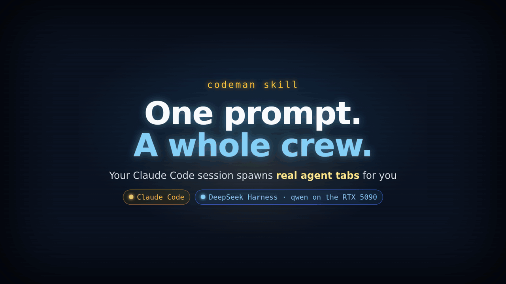

# The Codeman Skill

The codeman skill lets the agent inside a Codeman session drive Codeman itself. You ask in
plain English, and the agent starts worker sessions in any installed CLI, hands each one its
task, waits for them, reads their answers and cleans up after itself. No curl, no endpoint
names, no session ids in your prompt.

It is one skill for every agent CLI, in the `SKILL.md` format that Claude Code, Codex,
Gemini CLI, OpenCode, Grok, OMP and most other agent CLIs read. It lives in the repo at
[`skills/codeman`](https://github.com/Ark0N/Codeman/tree/master/skills/codeman).

## See it work

Three real runs on a live Codeman: real sessions, real agents, one typed prompt each.
Nothing on screen is mocked up; the long waits are sped up and labelled as time-lapse.

### Five workers in the tile grid

The lead Claude Code session gets `use codeman to start 5 claude workers, one per TODO item`,
and five Claude Code workers power on, one per item, with all six agents working at once.


Sessions an agent starts do not join the grid by themselves. In this recording each worker
was put on the grid as it started, the way `Ctrl`+click or dragging its tab does it: see
[Tile Grid](Tile-Grid).

### Eight workers, eight tabs

The same prompt with eight workers, in the normal view. Every worker gets its own tab, and a
lineage line runs from the lead to each one, so you can see who spawned whom. Clicking a
worker's tab shows it at work.


### Two CLIs from one prompt

Workers do not have to run the same CLI as the lead. Here the prompt is
`use codeman to have a dsh worker on qwen build search and a claude one build checkout`: a
DeepSeek Harness worker on a local qwen model and a Claude Code worker power on side by side.



## Install it

Usually you do not have to: since 1.50.0 Codeman puts the skill into every new session's
folder by default (the Web UI row below), where that session's CLI looks for skills. The copy
ignores itself in git, so your repository never lists it as a new file.

Otherwise pick one route. The skill only acts inside a Codeman session, so a global install is safe.

| How                | Command                                                                         | Scope |
| ------------------ | ------------------------------------------------------------------------------- | ----- |
| Skills CLI         | `npx skills add Ark0N/Codeman --skill codeman -g`                               | Global, any skills-aware agent. The way to give it to pi. |
| Claude Code plugin | `/plugin marketplace add Ark0N/Codeman`, then `/plugin install codeman@codeman` | Global, through Claude Code's plugin manager. `/plugin update codeman` follows releases. |
| Bundled CLI        | `codeman skill install`                                                         | Global, at `~/.claude/skills/codeman`. |
| Bundled CLI        | `codeman skill install --case <name> [--mode <mode>]`                           | One case. `--mode codex` (or any other run mode) writes it where that CLI looks for skills. |
| Web UI             | **App Settings → Agents & CLIs → All agent CLIs → Codeman Agent Skill**         | Injects it into each case when a session is created, where that session's CLI looks: `.claude/skills/` for Claude Code, `.agents/skills/` for Codex, Gemini CLI, OpenCode, Antigravity, Grok, DeepSeek and OMP. On by default since 1.50.0. |

Use the plugin **or** `codeman skill install`, not both: a Claude Code with both lists the
skill twice (`codeman` and `codeman:codeman`). The Web UI copy counts too, and it is on by
default: with the plugin installed, Claude Code sessions in Codeman list the skill twice.
Both work. Turn **Codeman Agent Skill** off if the duplicate bothers you (other CLIs then
lose their copy too), or use the Web UI copy instead of the plugin.

The web UI route skips pi, because a project skill makes pi ask to trust the folder at
startup. A pi or plain shell session uses the [`codeman agent`
commands](Driving-Codeman-From-An-Agent#the-codeman-agent-commands) instead, which are the
same verbs as shell commands.

### Remove it

`codeman skill uninstall [--case <name>]` reverses the CLI installs (with `--case`, every
Codeman-managed copy in that case, whichever CLI's directory it sits in). It never touches a
`skills/codeman` you wrote yourself.

To stop the Web UI copy, turn **App Settings → Agents & CLIs → All agent CLIs → Codeman Agent
Skill** off. It is on by default since 1.50.0: a settings file without the setting means on,
and only switching it off turns it off. Existing installs that stored off are switched on
once at the first 1.50.0 start (every App Settings save on an earlier version stored the old
default, off, whether or not you touched this switch); turning it off afterwards sticks.

Turning the web UI setting off **does not remove copies it already injected**, because
a sweep at session start would pull the skill out from under other live sessions sharing
that directory. Remove them per case with `codeman skill uninstall --case <name>`, which
also removes the copy's `.gitignore`.

## Then just ask

These prompts work as written:

| You say                                                                                   | What happens |
| ----------------------------------------------------------------------------------------- | ------------ |
| "What sessions are running right now?"                                                     | Lists them with name, mode and status. Read-only. |
| "Use codeman to start 5 claude workers, one per TODO item."                                | One worker per item, each handed its task, answers gathered as they finish. |
| "Start a shell worker on the `myapp` case, run the test suite, tell me if it passes."      | Spawns, waits on a completion marker, reads the exit code, cleans up. |
| "Spin up 3 workers for lint, typecheck and tests, run them in parallel, report failures."  | One session per task, all started first, then gathered as each finishes. |
| "Have a claude worker summarize `src/session.ts`, then close it."                          | Spawns, waits until the worker is ready, sends and waits, reads the answer, deletes the session. |
| "Have a DeepSeek Harness worker build search and a claude worker build checkout."          | A mixed fleet: one worker per CLI, started in one go. |
| "Use the local model to summarize every file in `docs/`, then check its summaries."         | A worker on the model Codeman installed on this Mac does the bulk; the lead reads its answer back and reviews it. Without a local model, it says why. |
| "Watch session w4 and tell me if it gets stuck on a permission prompt."                    | Blocks on the `blocked` signal and brings the question to **you**. |

Sessions the agent creates are deleted when it is done, so you can watch the tabs appear and
disappear in the dashboard while it works.

### A run, start to finish

> **You:** spin up 3 shell workers, run lint / typecheck / the frontend syntax check in
> parallel, and tell me which failed.

```text
lint       -> 9f2d8e5f   dispatched
typecheck  -> aff9c691   dispatched     3 tabs appear in the dashboard
syntax     -> be9f1f15   dispatched

lint         DONE_lint_17909      rc=0
typecheck    DONE_typecheck_3409  rc=0   gathered as each one finishes
syntax       DONE_syntax_18501    rc=0

deleted 9f2d8e5f, aff9c691, be9f1f15    tabs disappear
```

The `DONE_<task>_<random>` strings are the
[split-marker trick](Driving-Codeman-From-An-Agent#the-split-marker-trick): a shell session
has no "turn finished" signal, so the skill waits for a marker in the output, typed in two
halves so that only the command's real output ever contains the joined string.

## Which workers it can drive

Any run mode installed on the machine can be a worker. Claude Code and DeepSeek Harness are
the two with real completion signals (Claude's from its hooks, DeepSeek's from the harness),
so the skill can wait for "turn finished" and read the answer as clean text. Every other CLI
and plain shell sessions are synchronized on an output marker instead, which works the same
from your side. See [Agent CLIs](Agent-CLIs) for the run modes.

**The model on this Mac is a worker too.** When Codeman has installed a local model
([A model that runs on this Mac](Custom-Model-Endpoints#a-model-that-runs-on-this-mac)), a
Claude Code lead can hand work to it: Claude in the cloud plans and reviews, the local model
takes summaries, first drafts and files that should stay on the machine. It answers one
request at a time and is slower than a cloud model, and the skill never installs one for you.
You can name the coding agent the worker runs with ("a local worker with Pi"), as long as
that agent is installed; the walkthrough is in [Local Models](Local-Models#cloud-and-local-together).

With Claude Code workers, where the installed Claude Code supports it, the lead can also
message a worker directly instead of typing into its terminal.

## What it will and will not do

- **It self-gates.** Outside a Codeman session (`CODEMAN_MUX` unset) it refuses every live
  API operation and never guesses an API URL, so a global install cannot drive a server it
  is not part of. The one exception is reading saved Codex conversations with
  `codeman history read` (see [Driving Codeman From An Agent](Driving-Codeman-From-An-Agent#reading-saved-codex-conversations)),
  a local, read-only command that needs no server or session.
- **Unprompted, it may only** start sessions, prompt them, and delete the ones **it created
  in that conversation, by exact id**, behind a guard that refuses to delete the agent's own
  session.
- **It will not** answer another session's permission prompt on your behalf. It brings the
  question to you instead.
- **Only when you ask, naming the target:** deleting a case (which erases a real directory
  of your code), bulk kills, respawn, Ralph, cron, the orchestrator, and settings changes.

## When the agent is Codex

Two things to know:

- Codex's default sandbox blocks network access, even to this machine, so a Codex session
  needs **Allow network access** (App Settings, Codex) before it can start and drive
  others. The setting is app-wide: it applies to every local Codex session started after
  you switch it on, not only the ones you mean to orchestrate. It also has a cost: commands
  in Codex's sandbox can then call Codeman's API, which can start a session outside the
  sandbox with no approval prompt, even when a password is set, so the sandbox no longer
  contains a prompt-injected command. See
  [Security](Security#what-codeman-does-not-protect-against). It opens the network only
  where Codex runs the folder in its workspace-write sandbox, which is what Codex does for
  a project you trusted. It does not change Codex's sandbox mode: a folder Codex runs
  read-only (a new case that is not a git repository, for one) keeps the network closed,
  and Codex asks you to approve each call to Codeman. Trust the project in Codex, or use `/permissions` in
  Codex for that session, to get workspace-write there. **Bypass approvals and sandbox**
  works everywhere, but removes the sandbox and the approval prompts.
- Codex 0.162 runs its commands in a shared background process, whose Codeman variables can
  belong to the session that started it. Codeman starts a local Codex 0.162 or later with
  `--no-daemon`, so each session runs its own. A remote or Docker session does not get the
  flag, and neither does a local one whose Codex version Codeman could not read; there,
  and with an older Codex, the skill notices and says so instead of acting.

OpenCode and DeepSeek Harness need nothing extra: in their default setup neither keeps its
shell commands off the network, so the skill works there as soon as it is injected.

## What is in the skill

| File | Contents |
| ---- | -------- |
| [`SKILL.md`](https://github.com/Ark0N/Codeman/blob/master/skills/codeman/SKILL.md) | Safety rules, the fast path (start N workers, task them, collect the answers) and the verb index. Always loaded. |
| [`reference/verbs.md`](https://github.com/Ark0N/Codeman/blob/master/skills/codeman/reference/verbs.md) | Every verb in detail: readiness, send-and-wait, markers, interrupts, cleanup. Loaded on demand. |
| [`reference/recipes.md`](https://github.com/Ark0N/Codeman/blob/master/skills/codeman/reference/recipes.md) | Worked flows: claude, DeepSeek Harness and shell workers, fan-out, watching a blocked worker, messaging. Loaded on demand. |
| [`reference/endpoints.md`](https://github.com/Ark0N/Codeman/blob/master/skills/codeman/reference/endpoints.md) | Endpoint tables, error codes, the signals each mode emits, capacity limits. Loaded on demand. |
| [`reference/messaging.md`](https://github.com/Ark0N/Codeman/blob/master/skills/codeman/reference/messaging.md) | Talking to claude workers directly through Claude Code's cross-session messaging. Loaded on demand. |
| [`reference/history.md`](https://github.com/Ark0N/Codeman/blob/master/skills/codeman/reference/history.md) | Reading saved Codex conversations offline with `codeman history read`: selectors, filters, forks, budgets. Loaded on demand. |
| [`reference/inspection-and-staging.md`](https://github.com/Ark0N/Codeman/blob/master/skills/codeman/reference/inspection-and-staging.md) | Experimental and opt-in (App Settings, Experimental agent coordination): bounded pane inspection and guarded submission with `codeman agent inspect`, `stage` and `submit`. Loaded on demand. |

Only `SKILL.md` sits in the agent's context; the references load when a job needs them, so a
quick run stays quick.

## Read next

- [Driving Codeman From An Agent](Driving-Codeman-From-An-Agent) - the `codeman agent`
  commands, the MCP server, and the raw HTTP rules the skill is built on.
- [Tile Grid](Tile-Grid) - watching several workers side by side.
- [The Dashboard](The-Dashboard) - tabs, lineage lines and status dots.
- [Watching Agents Work](Watching-Agents-Work) - the subagents inside each session.
